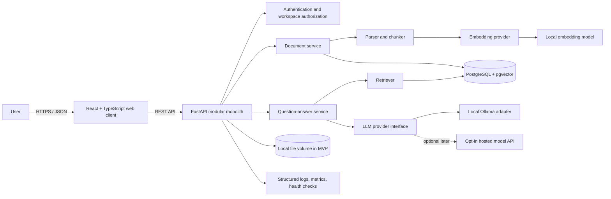
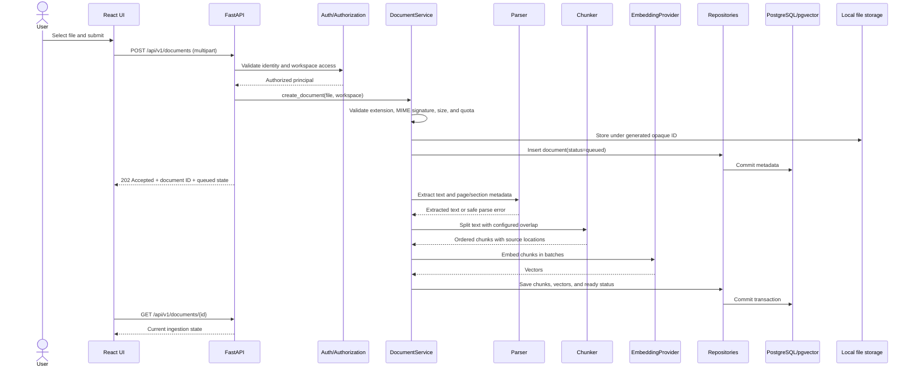
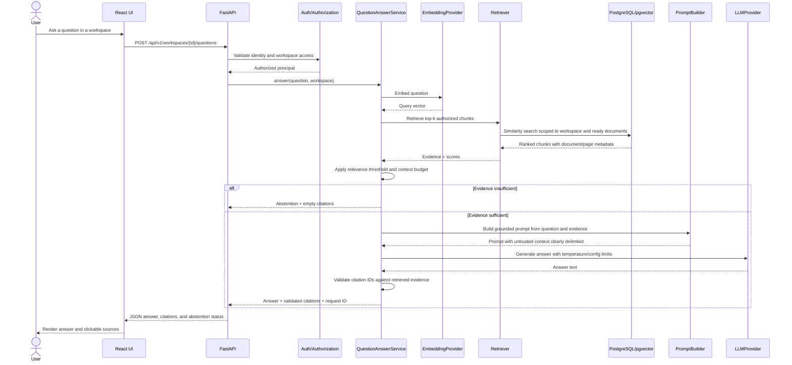
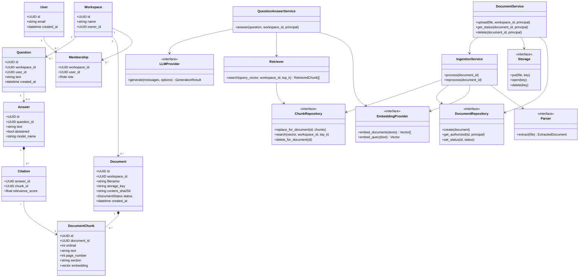

# Project specification: Evidence-backed Knowledge Assistant

**Status:** Build specification  
**Target role alignment:** Backend / platform / applied-AI engineer (UK, Germany, Netherlands, France)  
**Project type:** Portfolio-grade modular monolith; local-first, cloud deployment optional  
**Core rule:** This is an information-retrieval and summarization tool, not a source of professional, legal, medical, or financial advice.

## 1. Executive summary

Build a web application that lets a signed-in user create a private knowledge workspace, upload documents they are authorized to use, ask natural-language questions, and receive concise answers grounded in those documents. Every factual answer should cite the source document and page or section where available. If the retrieved material does not support an answer, the assistant should say it cannot find sufficient evidence rather than inventing an answer.

The portfolio goal is to turn the existing enterprise knowledge-assistant experience into a demonstrable, documented service with a Python API, React/TypeScript client, PostgreSQL/pgvector, repeatable tests, containerized local development, CI, and an optional cloud deployment. Start as one deployable application with clear module boundaries; do not add microservices, Kafka, Kubernetes, or paid cloud dependencies to the MVP without a measured need.

## 2. Goals and non-goals

### Goals

- Upload, list, inspect, and delete documents within a user's workspace.
- Support PDF, DOCX, and TXT for the first release; reject unsupported or oversized files with useful errors.
- Extract text, split it into overlapping chunks, create embeddings, and store chunks with source metadata.
- Answer questions using retrieved chunks and a language-model provider, with source citations in the response.
- Enforce workspace ownership on every document and query operation.
- Provide ingestion state (`queued`, `processing`, `ready`, `failed`) and meaningful failure messages.
- Make the project runnable locally with Docker Compose and documented setup steps.
- Demonstrate quality with automated tests, CI, an evaluation dataset, and measured results.

### Non-goals for the MVP

- Training a foundation model or claiming novel ML research.
- Multi-tenant enterprise SSO, billing, collaboration, or a complex admin console.
- Guaranteed production-grade scale or availability.
- Medical diagnosis, legal advice, or automated decisions about people.
- Real patient records, confidential employer material, copyrighted corpora without permission, or private personal data.
- Claiming AWS/Azure/GCP, Kubernetes, Kafka, or Python professional experience before actually using them.

## 3. User stories and acceptance criteria

1. **Upload documents:** A user uploads one or more allowed files; each file is uploaded and processed separately. The API validates file type and size, creates a document record, and returns its ID and ingestion state. A rejected file produces a clear 4xx response and is not indexed, without affecting the other files.
2. **Ingest a document:** The system extracts text, creates chunks and embeddings, and marks the document `ready`. A parser or provider failure marks it `failed` with a safe, user-visible explanation; internal logs retain diagnostic details without secrets or document text by default.
3. **Ask a question:** A user asks a question in their workspace. The service retrieves only chunks belonging to documents they can access, generates a grounded response, and returns citations linked to the correct document and page/section.
4. **Handle unsupported questions:** If retrieval finds insufficient evidence, the API returns an abstention response and no fabricated citations.
5. **Delete data:** Deleting a document removes its chunks and embeddings and makes it unavailable to retrieval. The behavior of backups and object storage must be documented if cloud storage is later added.
6. **Operate locally:** A new contributor can follow the README to start the system, apply database migrations, run tests, and use a sample corpus without cloud credentials.
7. **Demonstrate quality:** CI runs formatting/lint checks and tests. A versioned evaluation set reports retrieval and answer-grounding outcomes; only measured values are published.

## 4. Architecture and technology decisions

| Concern | MVP choice | Why / boundary |
|---|---|---|
| Frontend | React + TypeScript + Vite | Demonstrates React while keeping a small, typed client. |
| API | Python 3.12+ / FastAPI | Typed REST API, OpenAPI docs, suitable for learning modern Python backend practices. |
| Validation | Pydantic | Validate request/response contracts at API boundaries. |
| Authentication | Local email/password accounts: Argon2id password hashes (argon2-cffi) and server-side sessions in an HttpOnly cookie | Simple and free, and supports several users so workspace isolation can be tested. No custom cryptography; a full auth provider is deferred (§15). |
| Persistence | PostgreSQL + pgvector | One database for users, workspaces, documents, chunks, and vector search. |
| ORM/migrations | SQLAlchemy 2 + Alembic | Explicit schema models and repeatable migrations. |
| Document parsing | pypdf for PDF (pypdfium2 as fallback), python-docx for DOCX, UTF-8 decoding for TXT | Permissive licenses (BSD-3-Clause, MIT) that suit the MIT-licensed repository; PyMuPDF is AGPL-3.0 or commercial. Keep parsing isolated behind an interface; preserve page/section metadata where possible. No OCR in the MVP: a scanned PDF without a text layer fails with a clear message. |
| Embeddings | Sentence Transformers with `BAAI/bge-small-en-v1.5` (384 dimensions, MIT) on CPU; `all-MiniLM-L6-v2` (384 dimensions, Apache-2.0) as fallback | Local, repeatable, no per-call API bill; model and vector dimensions are configuration, not hard-coded assumptions. Tests use a deterministic fake embedder. |
| LLM | Provider interface; local Ollama adapter first (default model Qwen3-4B-Instruct-2507, Apache-2.0, pinned as the Ollama tag `qwen3:4b-instruct-2507-q4_K_M`); search-only mode (cited passages, no generated text) when no model is available; optional hosted adapter later | Local development avoids mandatory paid API; hosted provider is opt-in and clearly disclosed. |
| Retrieval | pgvector cosine similarity; add keyword/hybrid search only after baseline evaluation | Simple measurable first implementation; avoid premature complexity. |
| Ingestion | Background task interface; MVP may use FastAPI background task or a simple worker process | Keep slow parsing out of the HTTP request path. If reliability requires durable queues, add one later with tests and rationale. |
| Local runtime | Docker Compose: API, UI, PostgreSQL/pgvector, optional Ollama | Reproducible local environment; local model resource needs depend on the developer's machine. |
| Test/quality | pytest, HTTPX, Ruff, mypy or pyright, Vitest/React Testing Library, Playwright smoke path | Verify business behavior, not only line coverage. |
| CI | GitHub Actions | Re-run lint, type checks, tests, and build on pull requests. No secrets required for core CI. |
| Cloud (later) | One provider only, likely AWS if target vacancies support it | Use managed Postgres, object storage, and container hosting only after local MVP works; monitor costs and destroy resources when not needed. |

**Architecture style:** modular monolith, with `api`, `documents`, `ingestion`, `retrieval`, `generation`, `auth`, and `persistence` modules. The provider interfaces make later substitutions testable without creating a network of services. The initial source of truth for document status and metadata is PostgreSQL. For the MVP, files can live in a local data volume; cloud object storage is a later adapter, not a dependency.

**Phase 0 choices (2026-10-28):** the authentication, document parsing, embeddings, and LLM rows above record the chosen configuration. Users upload whichever documents they are allowed to use; the repository ships only synthetic sample documents written for this project. Licenses, alternatives, and open points are in the [decision log](docs/tracker/03-decisions-risks-issues.md).

## 5. System context and deployment view



The browser never connects directly to PostgreSQL, the embedding model, or the LLM provider. Secrets and provider configuration stay on the server. User-provided document text is untrusted input, including text that attempts to instruct the model.

## 6. End-to-end code flows

### 6.1 Document ingestion



Implementation note: upload returns promptly; status polling (or later server-sent events) reports progress. If any stage fails, use a transaction for database writes, mark the document failed, and remove temporary artifacts where safe. Make retries idempotent: reprocessing a document replaces its prior chunks rather than creating duplicates.

### 6.2 Question answering



### 6.3 Delete flow

Authorize the caller; mark the document as deleting or unavailable; delete chunk/vector rows in a transaction; delete the file from storage; mark deletion complete. If filesystem/object deletion fails, surface an operational error and retry safely rather than reporting success while data remains. Never allow a document ID guess to bypass workspace authorization.

## 7. Proposed code layout

```text
evidence-backed-knowledge-assistant/
  backend/
    app/
      main.py                 # FastAPI app and lifecycle
      api/v1/                 # routers and request/response schemas
      core/                   # settings, auth, errors, logging
      domain/                 # entities, enums, domain rules
      services/               # document, ingestion, Q&A use cases
      repositories/           # SQLAlchemy persistence adapters
      providers/              # parser, embedding, LLM, storage interfaces/adapters
      workers/                # ingestion worker entry point
    alembic/                  # Alembic migrations (alembic.ini beside it)
    tests/                    # unit, integration, API tests
    Dockerfile                # backend image, built from this folder
  frontend/
    src/
      api/                    # typed API client
      components/             # reusable UI components
      features/documents/      # upload, list, state, delete
      features/questions/      # question form, answer, citations
      features/workspaces/     # workspace selection
      routes/
    Dockerfile                # frontend image, built from this folder
  evals/
    questions.jsonl           # authored questions and expected source IDs
    README.md                 # evaluation method and limits
  infra/
    terraform/                # optional cloud deployment, later phase
  compose.yaml                # local stack: API, UI, PostgreSQL/pgvector
  .github/workflows/ci.yml
  README.md
  docs/                       # architecture, API, security, operations; tracker/
```

Folders are created when first needed. `alembic/`, `compose.yaml`, and a Dockerfile beside each build context follow the tools' own conventions.

Keep modules small and explicit. The class diagram below is a conceptual domain/service design, not a requirement that every concept become a class. Use functions where they are clearer.

## 8. Domain/class diagram



## 9. Data model and API contract

### Core tables

- `users`: identity ID, normalized email, Argon2id password hash (from argon2-cffi, a maintained library; no custom password cryptography), created timestamp.
- `user_sessions`: ID, user ID, hash of the random session token, created and expiry timestamps. The raw token exists only in the user's HttpOnly cookie.
- `workspaces`: ID, name, owner ID, created timestamp.
- `workspace_memberships`: workspace ID, user ID, role, unique constraint on the pair.
- `documents`: ID, workspace ID, original display name, opaque storage key, MIME type, byte size, SHA-256, status, safe failure code/message, timestamps.
- `document_chunks`: ID, document ID, ordinal, text, page/section metadata, embedding vector, created timestamp. Add indexes for foreign keys and vector search; confirm pgvector index choice against the selected distance/operator and measured dataset size.
- `questions`, `answers`, `citations` (optional for MVP persistence): store only what is needed for usability/evaluation. Define retention and deletion behavior before storing potentially sensitive question text.

### Initial REST endpoints

- `POST /api/v1/auth/register`, `POST /api/v1/auth/login`, `POST /api/v1/auth/logout`, `GET /api/v1/auth/me` — local accounts and the session cookie; registration can be turned off in settings. State-changing requests also require a custom header, so other local sites cannot forge them.
- `POST /api/v1/workspaces` — create workspace.
- `GET /api/v1/workspaces` — list accessible workspaces.
- `POST /api/v1/workspaces/{workspace_id}/documents` — upload; returns `202` and document status.
- `GET /api/v1/workspaces/{workspace_id}/documents` — list documents and ingestion status.
- `GET /api/v1/documents/{document_id}` — get status/metadata, after authorization.
- `DELETE /api/v1/documents/{document_id}` — delete document and indexed chunks.
- `POST /api/v1/workspaces/{workspace_id}/questions` — ask a question; returns answer, citations, and abstention flag.
- `GET /health/live` and `/health/ready` — process and dependency readiness; do not leak credentials/configuration.

Use consistent error JSON with a stable code, human-readable message, and request ID. Never echo stack traces, provider credentials, or uploaded content in error responses.

## 10. Implementation roadmap and definition of done

### Phase 0 — Confirm environment and decisions
- Check Python/Node/Docker versions and available memory/disk before choosing local model sizes.
- Select an openly licensed, small sample corpus or create synthetic documents; record source and license.
- Decide local auth mode and local LLM/embedding model based on machine capability.
- **Done when:** the chosen configuration is written down and no paid account or real sensitive data is required for the default path.

### Phase 1 — Repository and local foundation
- Create backend/frontend directories, pinned dependencies/lock files, configuration template, Docker Compose, Postgres with pgvector, health endpoint, lint/type/test commands, and CI.
- Add `.env.example`, ignore local secrets and uploaded files, and document startup/teardown.
- **Done when:** a clean checkout starts locally and CI passes without secrets.

### Phase 2 — Workspace and document lifecycle
- Implement identity/auth guard, workspace ownership, migrations, upload validation, storage adapter, document list/status/delete endpoints and UI.
- Validate actual content signatures where practical; sanitize display names; generate storage paths server-side; set explicit file-size limits.
- **Done when:** tests prove unauthorized users cannot list, query, download, or delete another workspace's documents; invalid uploads are rejected.

### Phase 3 — Ingestion and semantic indexing
- Implement PDF/DOCX/TXT parsers behind an interface; normalize text while retaining source locations; chunk with configurable size/overlap; embed in batches; persist chunks/vectors; expose status and retry.
- **Done when:** fixture documents produce expected text/pages/chunks; duplicate retry does not duplicate chunks; parser/provider errors result in `failed` status and recoverable logs.

### Phase 4 — Grounded question answering
- Implement question embedding, workspace-scoped retrieval, relevance threshold, context budget, prompt builder with untrusted-source delimiting, provider adapter, citation validation, abstention, and answer UI.
- **Done when:** integration tests confirm correct citations, no cross-workspace retrieval, and abstention on unsupported questions. Document model/provider limitations.

### Phase 5 — Evaluation and hardening
- Create a small manually reviewed evaluation set with question, expected document/page, and expected answer facts. Measure retrieval hit rate/recall at k and citation correctness. Evaluate unsupported questions and prompt-injection-like content as robustness tests, not as proof of security.
- Add rate limits, request size limits, dependency checks, structured logs, metrics, trace/request IDs, and privacy/retention notes.
- **Done when:** results are reproducible from a documented command, trade-offs are stated, and no fabricated benchmark claims appear in README or CV.

### Phase 6 — Portfolio polish and optional deployment
- Add accessibility and browser smoke tests; architecture/API/security/operations docs; screenshots; demo data; clear limitations.
- Deploy only after estimating costs. Use one cloud, least-privilege identity, restricted network access, managed secrets, HTTPS, backups, resource budgets, and teardown steps. Never commit secrets or expose a database publicly.
- **Done when:** an external reviewer can understand the architecture, run the app, inspect tests/evaluation, and reproduce the demo. Cloud deployment is optional; no permanent free tier is assumed.

## 11. Quality strategy

- **Unit tests:** chunk boundaries/overlap, parser normalization, relevance threshold/abstention, citation mapping, auth policy.
- **Integration tests:** migrations, repositories, vector retrieval, ingestion, deletion, provider failures. Use a test PostgreSQL/pgvector container or a documented compatible test setup; do not mock away the database behavior being claimed.
- **API tests:** status codes, payload schemas, invalid uploads, ownership boundaries, failed dependencies.
- **Frontend tests:** upload validation and state, loading/empty/error states, citation links, keyboard/accessibility behavior.
- **End-to-end smoke:** create workspace, upload a known fixture, wait for `ready`, ask a question with a known answer, verify citation, ask an unsupported question, verify abstention, delete document.
- **CI checks:** Ruff, type checking, pytest, frontend lint/typecheck/unit tests, production build, dependency vulnerability checks where available.
- **Evaluation:** version evaluation data and model/config versions; report test set size and method. Do not compare scores across different corpora/configurations as if directly equivalent.

## 12. Security, privacy, and operational requirements

- Treat all file names, MIME headers, document text, questions, and model output as untrusted.
- Enforce identity and workspace authorization in service/repository queries, not only in the UI.
- Use server-generated storage keys; prevent path traversal; limit file size/page count and parsing time; consider decompression bombs and malformed files.
- Store secrets in environment/secret manager, never in Git or frontend bundles. Keep logs free of secrets, full document content, and unnecessary personal data.
- Use parameterized database access, migrations, dependency updates, secure cookies/token practices, CORS allowlists, and rate limits.
- Delimit retrieved text as untrusted evidence in prompts; the model must not follow instructions found inside documents. This mitigates but does not eliminate prompt-injection risk; authorization and tool permissions must not depend on model compliance.
- Validate citation identifiers against retrieved chunks; model-generated URLs/IDs are not trusted.
- Define data retention and deletion. Make local data directories easy to clear; for a hosted demo, disclose provider data handling and retention before sending user content to third parties.
- This project is not certified for regulated/clinical workloads. Use public or synthetic documents only.

## 13. Free/local development and cost controls

The core can be developed locally without a cloud bill using PostgreSQL/pgvector (in Docker Compose, or natively without containers; see the quickstart), a local embedding model, and optionally Ollama. Local model inference can require substantial RAM/disk and may be slow; a small hosted model is a convenience, not a free guarantee. Keep the provider API optional and make its use explicit. Avoid creating always-on cloud databases, Kubernetes clusters, NAT gateways, or GPU instances for a portfolio demo. If testing cloud, set billing alerts and a budget where available, choose short-lived resources, document teardown, and verify current provider pricing/free limits first.

## 14. Portfolio and resume evidence

Only after completing each item, add truthful evidence to the resume and portfolio:

- Python/FastAPI API design and validated REST contracts.
- React/TypeScript client and accessible interaction states.
- PostgreSQL schema/migrations and pgvector retrieval implementation.
- Document parsing, asynchronous ingestion, retry/idempotency behavior.
- Grounded generation with validated citations and explicit abstention.
- Docker-based repeatable environment and CI automation.
- Security/privacy controls, evaluation methodology, and measured results.
- AWS deployment only if actually deployed and operated; describe exact services and scope.

Resume bullet template (replace brackets with verified values): “Built a Python/FastAPI and React knowledge assistant using PostgreSQL/pgvector, with document ingestion, citation-backed RAG, workspace authorization, and Docker-based CI; evaluated [N] curated questions and measured [specific result] under [test conditions].” Do not list a skill as hands-on project experience until the corresponding implementation exists.

## 15. Decisions intentionally deferred

- Hosted model vendor and exact model, based on privacy, cost, availability, and evaluation.
- Whether a newer, permissively licensed small model should replace the default local model (`qwen3:4b-instruct-2507-q4_K_M`), based on evaluation.
- Cloud provider and deployment service, pending current target-job research and cost estimate.
- Whether durable queueing is needed, based on observed ingestion reliability and workload.
- Keyword/hybrid search, reranking, and additional vector index tuning, based on evaluation evidence.
- Full authentication provider, if the project is used beyond a portfolio demo.

## 16. Suggested first implementation milestone

The first coding milestone should be **Phase 1 only**: create a clean repository foundation with Docker Compose, health checks, configuration, migrations setup, CI, and a minimal React/FastAPI shell. Verify a new checkout starts and tests pass before implementing ingestion or AI. This keeps the project incremental and makes each skill demonstrable through real code rather than a large untested first commit.

## Phase 1 foundation quickstart

The initial scaffold is in place; it provides the API and database readiness checks plus a minimal web landing page. It does **not** yet implement workspaces, document ingestion, retrieval, or AI generation.

From the project root, copy `.env.example` to `.env`, then run:

```powershell
docker compose up --build -d
docker compose run --rm backend alembic upgrade head
```

Open `http://localhost:5173`; the page reports whether the API and PostgreSQL are ready. The API health endpoints are `http://localhost:8000/health/live` and `http://localhost:8000/health/ready`. Backend dependencies are locked in `backend/uv.lock`; install [uv](https://docs.astral.sh/uv/getting-started/installation/) first (CI uses uv 0.13.5). Run backend checks from `backend` with `uv sync --locked --extra dev`, then `uv run ruff check .`, `uv run ruff format --check .`, `uv run mypy app`, and `uv run pytest`; run frontend checks from `frontend` with `npm ci`, `npm run lint`, `npm run typecheck`, `npm test`, and `npm run build`. Stop local services with `docker compose down`; add `-v` only if you intentionally want to delete the local database volume.

### Without containers (no administrator rights)

On Windows, Docker Desktop, Podman, and Rancher Desktop all run Linux in a virtual machine through WSL 2 or Hyper-V, and turning those on needs administrator rights. Podman Desktop on its own is only a GUI: it still needs the Podman engine and that virtual machine. Without them, run PostgreSQL, the API, and the web app as ordinary user processes; this needs no virtual machine, cloud account, or paid API. These steps were checked on Windows; on other systems, use your platform's PostgreSQL 16 and pgvector packages.

One-time setup:

1. Put PostgreSQL 16 and pgvector 0.8.0 in a folder you own. EDB's [Windows binaries zip](https://www.enterprisedb.com/download-postgresql-binaries) needs no installer: extract `bin`, `lib`, `include`, and `share`. Build [pgvector from source](https://github.com/pgvector/pgvector/tree/v0.8.0#windows) with Visual Studio's C++ build tools, with `PGROOT` set to that folder: `nmake /F Makefile.win`, then `nmake /F Makefile.win install`. Neither step needs administrator rights when the folder is yours.
2. With PostgreSQL's `bin` folder on `PATH`, create a database cluster and the project database. Enter the password from `.env.example` when prompted: with the user name, password, and database name from `.env.example`, the backend's default settings connect without a `.env` file.

   ```powershell
   initdb -D <data-folder> -U knowledge_assistant -A scram-sha-256 -E UTF8 --locale=C --pwprompt
   pg_ctl -D <data-folder> -l <log-file> start
   createdb -U knowledge_assistant knowledge_assistant
   ```

   `initdb -U knowledge_assistant` makes that user the cluster's superuser, which the first migration needs for `CREATE EXTENSION vector`. Use this cluster for local development only.

To run the app, start the database if it isn't running (`pg_ctl -D <data-folder> -l <log-file> start`). Then, from `backend`:

```powershell
uv sync --locked --extra dev
uv run alembic upgrade head
uv run uvicorn app.main:app --reload
```

In a second terminal, from `frontend`:

```powershell
npm ci
npm run dev
```

`uv sync` and `npm ci` are only needed after a fresh clone or a lock file change. Open `http://localhost:5173`; the page should report that the API and database are ready. PostgreSQL, the API, and the Vite dev server listen on localhost only, so other machines on your network can't reach them. Stop the web app and the API with Ctrl+C, then the database with `pg_ctl -D <data-folder> stop`. This database and the Compose `db` service both use port 5432: run only one of them, or set `POSTGRES_PORT` in `.env` to move the Compose one.

## License

Released under the [MIT License](LICENSE).
