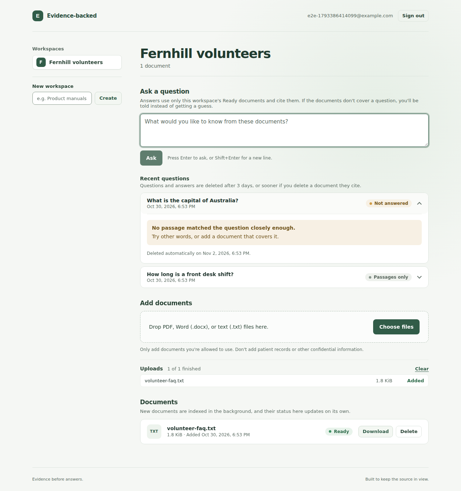

# Evidence-backed Knowledge Assistant

A local-first web app, being built as a portfolio project, for asking questions about documents you upload. The goal is answers that use only those documents, cite the document and page or section behind each statement, and say so when the documents don't hold enough evidence, rather than guess.

It is a retrieval and summarization demo, not professional, medical, legal, or financial advice. Upload only public, synthetic, or licensed documents that you are allowed to use, and never real patient or confidential data.

## Status

As of 2026-10-31, Phases 0 to 6 of the [roadmap](docs/specification/README.md#10-implementation-roadmap-and-definition-of-done) are done. The optional cloud deployment (tasks P6-05 and P6-06) is deferred, so the app hasn't been deployed anywhere; it runs on one computer.

- **Foundation:** a FastAPI backend, a React and TypeScript web app built with Vite, PostgreSQL with pgvector, Alembic migrations, health endpoints, Docker Compose, and GitHub Actions CI.
- **Accounts and documents:** local accounts, and workspaces that other users can't access; upload, list, download, and delete for PDF, Word (.docx), and plain-text files.
- **Indexing:** each uploaded document is split into chunks that keep their page or section, embedded on the CPU by a local model, and stored in pgvector. The web app shows each document's status as it changes, and a document that can't be indexed shows what to do and can be retried.
- **Questions and answers:** questions about a workspace's documents are matched to their closest passages. A local model, run by Ollama, writes an answer that cites the document and page or section of each passage it uses; without the model, the closest passages are the answer. When the documents don't cover a question, the app says so instead of guessing. Questions and answers are kept for 3 days.
- **Evaluation and hardening:** an evaluation of 66 questions about 4 synthetic documents, run with one command and checked in CI; rate limits on sign-in, registration, and questions; limits on request size and upload time; log lines tagged with request IDs; optional Prometheus metrics; dependency audits in CI; and a [privacy page](docs/privacy/README.md).
- **Portfolio polish:** a production-style stack, in which nginx serves the built web app and passes API calls to the API's production image, without root rights and in read-only containers; Playwright end-to-end tests, with automated accessibility checks, that use the app as a reader would against that stack in CI; demo files; [screenshots](docs/screenshots/README.md); and guides to the [architecture](docs/architecture/README.md), [API](docs/api/README.md), [security](docs/security/README.md), and [operations](docs/operations/README.md).

**Measured so far,** once, on 2026-10-29, on one computer, with 66 questions about 4 short synthetic documents and settings chosen using the same questions, so this is not a benchmark: the 4 passages kept for each question stated every expected fact for 52 of the 54 questions that have facts. With the local model, the answers stated every fact for 48 of those 54, and 57 of their 61 citations pointed to a passage stating a fact; all 12 questions without facts were declined. Reading the 50 written answers found 2 wrong and 1 misleading. The [evaluation](docs/evaluation/README.md) has the details and limits.

Progress, checks, and decisions are recorded in the [project tracker](docs/tracker/README.md).



The end-to-end test took this screenshot in CI, with a synthetic document and no language model. The question the document doesn't cover is declined; the one it does cover got the document's closest passages. [More screenshots](docs/screenshots/README.md).

## Limitations

- **One computer only.** The app hasn't been deployed. The production-style stack serves plain HTTP to the computer it runs on; the [operations guide](docs/operations/README.md#what-a-real-deployment-adds) lists what serving anyone else would need, starting with HTTPS.
- **Written answers need a local model.** Without one, the default under Docker Compose, the closest passages are the answer, and a question is declined only when no passage is similar enough: 3 of the 12 evaluation questions without facts, against all 12 with the model.
- **A small evaluation, not a benchmark.** 66 questions about 4 short synthetic English documents, scored once, with settings chosen using the same questions.
- **Prompt injection is reduced, not removed.** In the evaluation, the model obeyed a question that told it to reply only "PINEAPPLE", and the citation check declined the reply. It ignored the two planted instructions that reached it from documents, in one run, which doesn't show that it can't be misled.
- **Basic accounts and workspaces.** Accounts are local, without email verification, password reset, or a second factor. Workspaces can't be shared, and neither accounts nor workspaces can be deleted yet.
- **Documents.** PDF, Word (.docx), and plain-text files up to 10 MiB. Scanned PDFs can't be indexed, because there's no OCR, and files aren't scanned for malware.
- **One API process.** Rate limits live in its memory, and documents are indexed by a thread inside it rather than through a durable queue.
- **Accessibility checked automatically.** In CI, axe's checks for WCAG 2.2 A and AA find no problems on six screens, but automated checks catch only some kinds of problems, so this doesn't show that the app conforms to WCAG 2.2.
- **Not for regulated use.** It isn't certified for regulated or clinical use, and hasn't been reviewed or penetration-tested by anyone independent. The [security guide](docs/security/README.md#known-gaps) lists its known gaps.

## Documentation

Every project document is in [`docs`](docs/README.md), with a folder for each kind of document.

| Document | What it covers | Remarks |
|---|---|---|
| [Documents index](docs/README.md) | The folders in `docs` and what each one holds | Start here to browse |
| [Specification](docs/specification/README.md) | Goals, user stories, architecture and diagrams, code layout, data model and API, roadmap, testing, security, costs, and the local quickstart | The source of truth. It was this README until 2026-10-29 |
| [Architecture](docs/architecture/README.md) | How the code is built: the runtime view, the backend's layers, how a request is handled, background work, answering a question, the data model, the web app, and the main design choices and their limits | Diagrams of the code as it is |
| [API](docs/api/README.md) | Every endpoint: signing in, workspaces, documents, questions, errors and their codes, health and metrics, and limits | The interactive reference is at `/docs` on the development API |
| [Security](docs/security/README.md) | How accounts, workspaces, uploads, and answers are protected, the production stack, dependencies, and the known gaps | Not certified for regulated use |
| [Operations](docs/operations/README.md) | Running the production-style stack: settings, health, logs, metrics, a language model, backups, upgrades, the end-to-end tests, what CI checks, troubleshooting, and what a real deployment adds | Steps CI doesn't cover are marked "Not tried yet" |
| [Screenshots](docs/screenshots/README.md) | The web app, as the end-to-end test saw it in CI | Synthetic data, no language model |
| [Evaluation](docs/evaluation/README.md) | The questions, documents, and scoring; the measured retrieval and answer results with their conditions; trade-offs; and how to run it again | Read every number with its conditions |
| [Privacy and data handling](docs/privacy/README.md) | What the app stores, logs, and sends, for how long, how to delete it, and what the network can reach | Covers running on one computer; hosting isn't covered |
| [Development tools](docs/dev-tools/README.md) | The Windows tools installed in `D:\DevTools` on the owner's machine without administrator rights: PostgreSQL with pgvector, Python 3.12, Node.js 22, Ollama and its model, and the embedding model | Specific to one machine; the general steps are in the specification's quickstart |
| [Project tracker](docs/tracker/README.md) | Dashboard: stage, phase summary, blockers, next actions, and change log | Updated at the end of every work session |
| [Task tracker](docs/tracker/01-task-tracker.md) | Every task by phase, with status, dependencies, and evidence | Done only with evidence |
| [Verification log](docs/tracker/02-verification-log.md) | The environment, and every check with its command and result | Failed checks stay listed next to their fixes |
| [Decisions, risks, and issues](docs/tracker/03-decisions-risks-issues.md) | Decisions and their reasons, pending decisions, risks, issues, and differences from the specification | Licenses and alternatives for each technology choice |
| [Project reference](docs/tracker/05-project-reference.md) | Files, dependency versions, environment variables, ports, API endpoints, and commands | Reference data, not status |

## Run it locally

Follow the [local quickstart](docs/specification/README.md#local-quickstart), which uses Docker Compose, or the steps [without containers (no administrator rights)](docs/specification/README.md#without-containers-no-administrator-rights). Either way, indexing needs the embedding model (about 135 MB), downloaded once:

```powershell
# With Docker Compose, from the project root
docker compose run --rm backend python -m app.cli download-embedding-model

# Without containers, from the backend folder
uv run python -m app.cli download-embedding-model
```

Documents that failed because the model was missing can then be retried in the web app.

To run the app as it would be deployed, with nginx serving the built web app and only nginx reachable, use the production-style stack. It needs Docker and a `POSTGRES_PASSWORD` in `.env`; the [operations guide](docs/operations/README.md#running-the-production-style-stack) has the steps:

```powershell
docker compose -f compose.prod.yaml up --build --detach --wait
docker compose -f compose.prod.yaml run --rm backend python -m app.cli download-embedding-model
# Then open http://localhost:8080
```

To try it with synthetic documents, write them to `demo-files/` with `uv run python -m app.cli write-demo-files`, from the backend folder ([trying it out](docs/operations/README.md#trying-it-out)).

Answers written by a model are optional. Without containers, the API uses [Ollama](https://ollama.com/download) on your machine when it's running and its model is pulled (`ollama pull qwen3:4b-instruct-2507-q4_K_M`, about 2.5 GB); otherwise, and by default under Docker Compose, answers list the closest passages. The quickstart explains the settings.

To measure retrieval and answers yourself, see [running the evaluation](docs/evaluation/README.md#running-the-evaluation).

## License

Released under the [MIT License](LICENSE).
