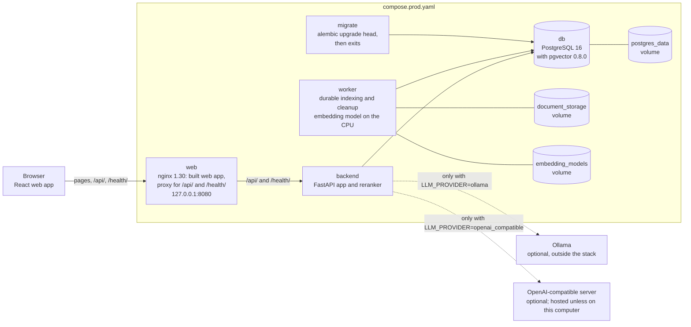
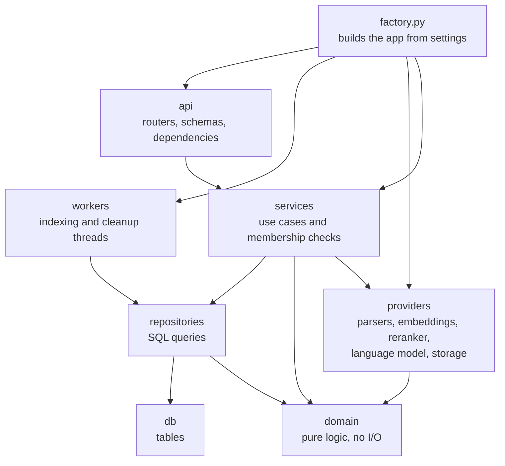
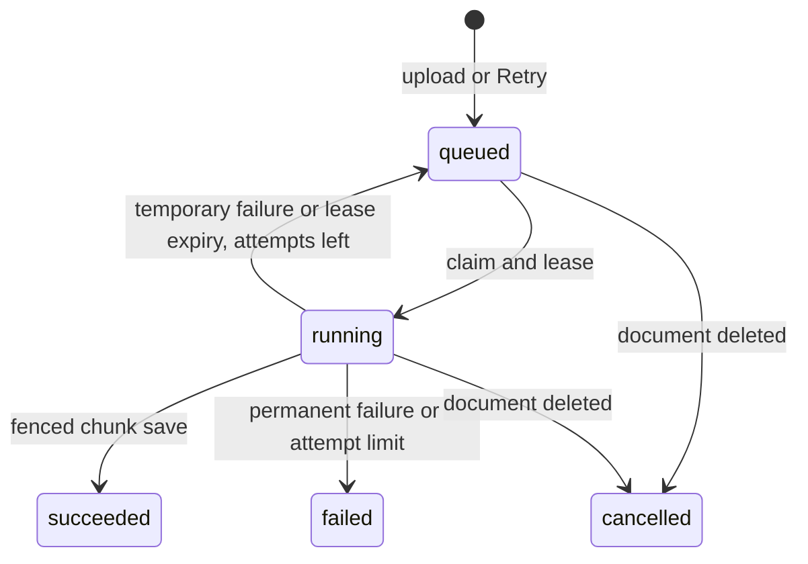
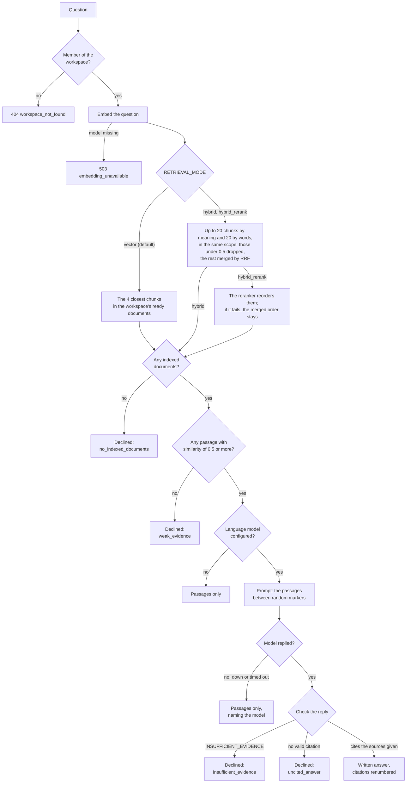
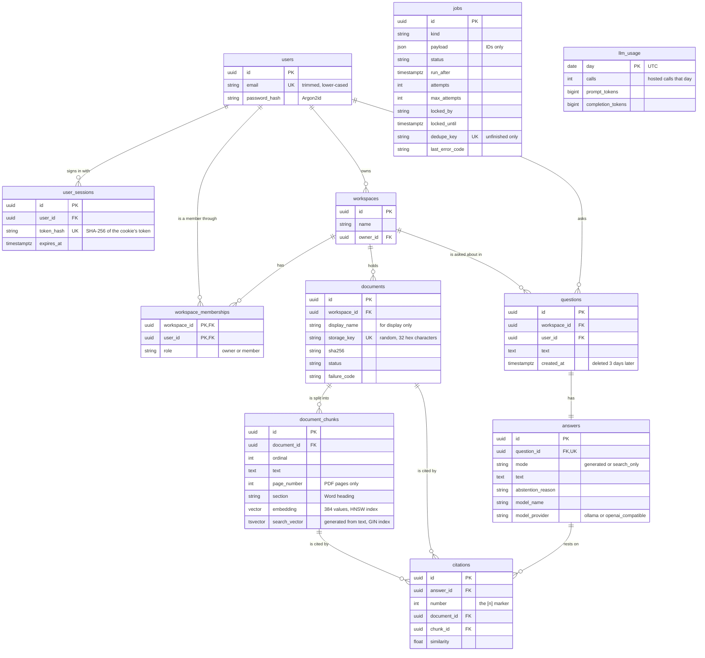

# Architecture

How the Evidence-backed Knowledge Assistant is built, as of Phase 8 (2026-11-01). The [specification](../specification/README.md#4-architecture-and-technology-decisions) records the design and the reasons for it. This page describes the code as it is, so a reviewer can find their way around it. Companion guides: [API](../api/README.md), [security](../security/README.md), and [operations](../operations/README.md).

## At a glance

- **One application with two runner choices.** `INDEXING_RUNNER=embedded` (the default) runs indexing in a thread inside the API; `worker` moves indexing and hourly cleanup to `python -m app.worker`. Both use PostgreSQL jobs, leases, and parser child processes. No external broker is used.
- **One database.** PostgreSQL 16 with the pgvector 0.8.0 extension holds the accounts, workspaces, documents, the text chunks with their embeddings, and the questions and answers. Vector search runs in the same database, in the same query that checks workspace membership.
- **Files on a volume.** Uploaded files are stored in a local folder under random names.
- **A static web app.** The React and TypeScript single-page app is built by Vite. In production nginx serves it; in development, Vite's dev server does.
- **Models on the server only.** The embedding model runs inside the selected indexing process, on the CPU, and so does the reranker in the API, in `hybrid_rerank` mode only. A language model is optional: Ollama runs outside the stack, and only the backend calls it, over HTTP.
- **The browser talks only to the API.** It never reaches the database, the stored files, or a model directly.

## Runtime view

The production-style stack, `compose.prod.yaml`, runs on one computer:

The `worker` Compose service is in the optional `worker` profile; CI enables it explicitly. Both stacks keep `embedded` as the default. The two Compose stacks differ like this:

| | Development: `compose.yaml` | Production-style: `compose.prod.yaml` |
|---|---|---|
| Web app | Vite's dev server on `127.0.0.1:5173` | nginx serving the built files on `127.0.0.1:8080` |
| API | Published on `127.0.0.1:8000`. The browser calls it directly, and CORS allows `http://localhost:5173` | Not published. The browser reaches it through nginx, on the web app's own origin, so CORS allows no origins |
| Database | Published on `127.0.0.1:5432` | Not published |
| Migrations | The `migrate` service runs them, and the API starts only after they succeed | The same |
| Worker | `worker` service, separate from the API | `worker` service, separate from the API; shares the file and model volumes |
| Images | Development targets, with the test tools | Production targets, without test tools and run by a user without root rights. The migration, API, worker, and web containers can't change their own files and have no Linux capabilities; the database runs the same pgvector image as in development |
| Logs | Text by default | JSON, one object per line |

Both stacks give the API the same settings, with production values where they differ, and CI checks that the two lists match. Running without containers is also supported ([quickstart](../specification/README.md#without-containers-no-administrator-rights)).

## Backend code layout

The backend is the `backend/app` package. Each folder is a layer, and imports go one way only:

| Folder or file | What it holds |
|---|---|
| `main.py`, `factory.py` | `create_app()` builds the app from settings: the database engine, the file storage, the embedding provider, the Ollama model when one is configured, the reranker in `hybrid_rerank` mode, the metrics, the workers, the middleware, the error handlers, and the routers. Tests call it with stand-ins, such as a fake embedder or a scripted model. |
| `api/` | HTTP. The routers for the health checks and for `/api/v1` (`auth`, `workspaces`, `documents`, `uploads`, `questions`), the Pydantic request and response models (`schemas.py`), and the dependencies in `deps.py`: the database session, the signed-in user, and the CSRF header check. |
| `services/` | The use cases: registering and signing in, workspaces, storing, retrying and deleting documents, indexing a document, finding a question's passages in the search mode set, and answering a question. Every service that touches workspace data checks membership itself. |
| `repositories/` | The SQLAlchemy queries, one module per group of tables. Every query that returns workspace data joins the memberships on the signed-in user. |
| `domain/` | Logic without I/O: file type and content checks, text normalization and chunking, the keyword query and reciprocal rank fusion, prompt building and the citation check, and the status and reason enumerations. It imports nothing else from the app, so its tests need no database or model. |
| `providers/` | Adapters behind small interfaces: parsers (pypdf, python-docx, UTF-8 text), embeddings (Sentence Transformers), the reranker (a Sentence Transformers cross-encoder), the language model (Ollama's chat API over HTTP), and file storage (a local folder). |
| `workers/` | The indexing loop and question cleanup thread; `worker.py` starts them in the standalone process. |
| `db/` | The SQLAlchemy table models, and helpers that create and empty the throwaway databases of the tests and the evaluation. |
| `core/` | Settings (pydantic-settings), the database engine, errors, logging, metrics, middleware, rate limits, and password hashing and session tokens. |
| `evaluation/` | The evaluation command: the corpus, the reviewed questions, the runner, the scoring, and the report ([evaluation](../evaluation/README.md)). |
| `cli.py` | `python -m app.cli` with five commands: `download-embedding-model`, `download-reranker-model`, `evaluate`, `compare-results`, and `write-demo-files`. |

The schema is created by Alembic migrations in `backend/alembic/versions`, `0001` to `0007`, never by the app.

## How a request is handled

1. **nginx**, in production, passes on `/api/` and `/health/`. It sets `X-Forwarded-For` to the address it received the request from, replacing any value the browser sent. Other paths are the web app's files.
2. **Middleware**, outermost first:
   - **Request ID:** gives each request a new random ID. The ID is returned in `X-Request-ID` and attached to every log line written during the request. IDs sent by the client are ignored.
   - **Access log:** one line per request, with the method, the route template rather than the actual path, the status, and the duration.
   - **CORS:** allows only the configured origins.
   - **Error fallback:** turns an unexpected exception into `500 internal_error`, in the usual error format.
   - **Body size limit:** refuses bodies over 64 KiB, apart from uploads, which have limits of their own.
3. **The `/api/v1` router** requires the header `X-CSRF-Protection: 1` on every POST and DELETE.
4. **Dependencies** open a database session and look up the user from the session cookie. Only registration, sign-in, and sign-out work without a signed-in user; every other endpoint under `/api/v1` answers 401 instead.
5. **The service** checks that the user is a member of the workspace. It answers 404 if not, so other users can't learn that a workspace exists. Then it does the work.
6. **Errors** raised as `AppError` become `{"error": {...}}` responses ([API guide](../api/README.md#errors)).

## Background work

### Indexing documents

An upload or Retry creates a `jobs` row and sends `NOTIFY` in the same PostgreSQL transaction as the document status change. The notification is delivered only after commit; the worker uses a dedicated autocommit `LISTEN` connection and still polls every 5 seconds in case it was offline. The job holds IDs only, never file or document text. A partial unique index deduplicates unfinished work by document.

1. Claim the oldest due job with one `UPDATE ... RETURNING`; its subquery uses `FOR UPDATE SKIP LOCKED`. The claim commits before work starts, increments `attempts`, and sets a 60-second lease.
2. A heartbeat every 15 seconds extends the lease. A reaper returns expired jobs to the queue or fails them after the fifth attempt. Each final write locks the job and fences on the current worker and unexpired lease; chunks and the successful job/document states commit together.
3. The parser runs in a child Python process with only the storage path, MIME type, parse limits, and a minimal environment. It receives no `DATABASE_URL` or application secrets. The parent kills it at `PARSE_TIMEOUT_SECONDS`; Linux also applies a 1.5 GiB address-space limit. Windows has no equivalent limit in this implementation.
4. The parent chunks the returned text and embeds it on the CPU. `embedding_unavailable`, `embedding_failed`, `ingestion_failed`, and `parse_timeout` are retried; other file-specific failures are terminal. Delays grow from 5 seconds exponentially, capped at 300 seconds, with plus or minus 20% jitter. Five starts are allowed.
5. A permanent failure ends with `failed` and the safe failure code. A document deleted during work cancels its unfinished jobs; a stale worker cannot save chunks after lease loss or cancellation.

The API exposes job counts by status and the age of the oldest queued job at `/metrics`. Document statuses remain `queued`, `processing`, `ready`, and `failed`; failed retries return to `queued`. The migration backfills jobs for pre-Phase-8 queued documents.

### Deleting old questions

The cleanup thread runs when the API starts in embedded mode, or in the worker process when `INDEXING_RUNNER=worker`, and then every hour. It deletes questions asked more than 3 days ago, with their answers and citations. The history already hides them once they're 3 days old, so the hour in between doesn't show.

### Why threads, and why one process

The default remains `embedded`, preserving the existing one-process local setup. `worker` moves indexing and cleanup out of the API, but the API still runs as one process: its rate limits are held in memory. The worker and API each load separate process state; the worker loads its own embedding model. In one Windows sample during indexing, the API used 134.4 MiB working set (852.6 MiB private bytes) and the worker 762.7 MiB working set (2,312.4 MiB private bytes). This is one observation, not a benchmark; worker mode remains opt-in. A parser child is bounded by the configured timeout and, on Linux, a memory limit.

## Answering a question

The [specification's sequence diagram](../specification/README.md#62-question-answering) shows the full exchange. These are the outcomes the code can reach:

- **No connection is held while models run.** The service ends its read transaction before embedding the question, and again before asking the model, which can take a minute or more.
- **Search is scoped in SQL.** One query joins the chunks to their documents and to the signed-in user's workspace memberships, keeps only `ready` documents, and orders by cosine distance through the HNSW index. The index is approximate, so a close chunk can occasionally be missed. Its strict-order iterative scan (`hnsw.iterative_scan = strict_order`) keeps searching past chunks from other workspaces, so the filter doesn't leave fewer than 4 results while enough exist, up to pgvector's scan limit.
- **The hybrid modes add a keyword search** (Phase 7). It joins the same tables, so it has the same scope, and matches any of the question's words against a `tsvector` that PostgreSQL generates from each chunk's text with its English configuration, through a GIN index, ranked by `ts_rank`. The words are taken as runs of letters and digits, so nothing typed in a question can become a text-search operator. Both searches return each passage's cosine similarity, so the same minimum of 0.5 applies in every mode. Reciprocal rank fusion (`RRF_K`, 60) merges the two rankings, and in `hybrid_rerank` mode a cross-encoder then reorders the merged passages, after the read transaction has ended. If the reranker fails, the merged order is kept, the failure is logged and counted (`knowledge_assistant_reranker_failures_total`), and the question is still answered. `vector` stays the default: `hybrid` tied with it on the held-out question set ([evaluation](../evaluation/README.md#the-choice)).
- **Answers are checked before they're stored.** The citation check drops any citation of a source the model wasn't given, and renumbers the rest. Before the answer is stored, the cited documents are locked and checked again. If one was deleted in the meantime, the API answers `409 answer_sources_changed` and the user asks again.

The prompt, the markers, and the check are described in the [security guide](../security/README.md#documents-that-try-to-instruct-the-model).

## Data model

The diagram shows the main columns only; `backend/app/db/models.py` has them all. The database itself enforces several rules:

- `documents.status` is one of `queued`, `processing`, `ready`, `failed`, or `deleting`, and membership roles are `owner` or `member`. Job status is `queued`, `running`, `succeeded`, `failed`, or `cancelled`; unfinished jobs have a lease and bounded attempts.
- An answer has text only when a model wrote it and didn't decline, and a written answer records the model that wrote it.
- Deleting a workspace, a document, a question, or an answer deletes what depends on it (`ON DELETE CASCADE`).
- `document_chunks.embedding` is a `vector(384)` with an HNSW index for cosine distance. HNSW works on an empty table, unlike IVFFlat, which needs data before it is built.
- `document_chunks.search_vector` is a `tsvector` that PostgreSQL generates from the chunk's text with its English configuration and stores, so it can't fall out of step with the text; a GIN index serves the keyword search. Migration `0006` adds both, and PostgreSQL fills the column for chunks that already exist. Migration `0007` adds `jobs`, with a partial unique dedupe index for queued/running jobs; its JSON payload contains the document ID only.

Workspaces are single-user for now: the creator is the only member, with the `owner` role. The `member` role is reserved for sharing, which the membership table already allows for.

## Web app

- **Stack:** React 19 and TypeScript 5.8, built by Vite 6. There's no router or state library: the app is one page, and its state lives in React components.
- **`src/api/`:** one module per area of the API. `client.ts` sends every request with the session cookie (`credentials: "include"`) and adds `X-CSRF-Protection: 1` to every POST and DELETE. It turns error responses into an `ApiError` with the API's error code and request ID. `parse.ts` checks each response's shape before the app uses it.
- **`src/features/`:**
  - `auth`: sign-in, registration, and the service status line.
  - `workspaces`: the list, the create form, and a workspace's home.
  - `documents`: the upload queue, the library, and the download and delete buttons.
  - `questions`: the question box, the history, answers, and their sources.
- **Live status:** while any document is `queued` or `processing`, the library reloads the list every 2.5 seconds. Status changes are announced to screen readers.
- **Where it sends requests:** the production build uses `VITE_API_BASE_URL=/`, so it calls the API on its own origin, through nginx. In development it calls `http://localhost:8000`.
- **What it keeps:** nothing apart from the session cookie, which is HttpOnly so scripts can't read it. It uses no local storage, and loads no fonts, scripts, or analytics from other sites.

## Main design choices and their limits

| Choice | Why | Limit, and what would change it |
|---|---|---|
| A modular monolith, one API process | One thing to run, test, and debug; in-memory rate limits remain consistent | Optional worker process for indexing; multiple API processes still need shared rate limits |
| PostgreSQL as the indexing queue | Durable jobs, notifications, leases, fencing, and retries in the existing database; no second queue service | One job kind and one embedding model. Worker mode duplicates model memory and stays opt-in until measured |
| pgvector in the main database | One store and one transaction for metadata and vectors. The membership check and the vector search are one query | Vector search by default. Keyword search (`hybrid`) and reranking (`hybrid_rerank`) are settings since Phase 7, but `hybrid` tied with vector search on the held-out set, and reranking hasn't been measured ([evaluation](../evaluation/README.md#the-choice)) |
| A small local embedding model, pinned to one revision | No per-call cost, results that can be repeated, and nothing sent to a third party | English-focused, and changing the model means indexing every document again |
| An optional local language model, with passages-only as the fallback | The app stays useful without a model or a GPU, and the evidence is always shown | Answers are slow on a CPU, and the model's quality limits the answers ([evaluation](../evaluation/README.md)) |
| Server-side sessions in an HttpOnly cookie, plus a CSRF header | Sessions can be revoked, and page scripts never see a token | The web app and the API must share a site, as they do behind nginx |
