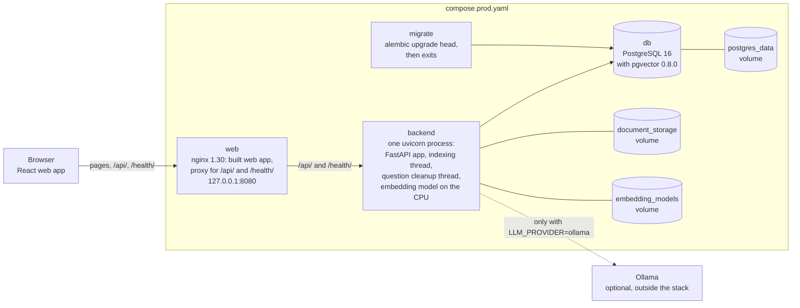
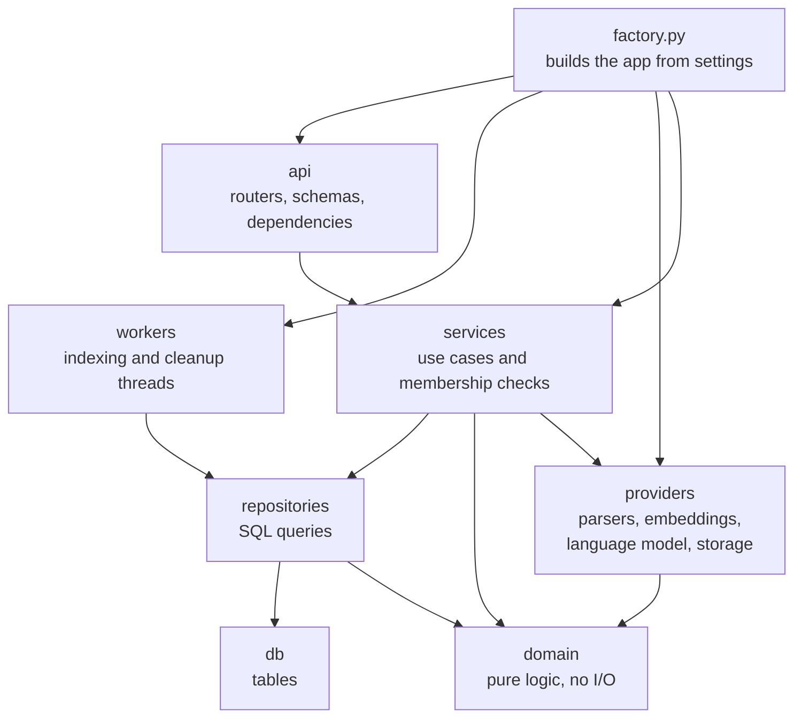
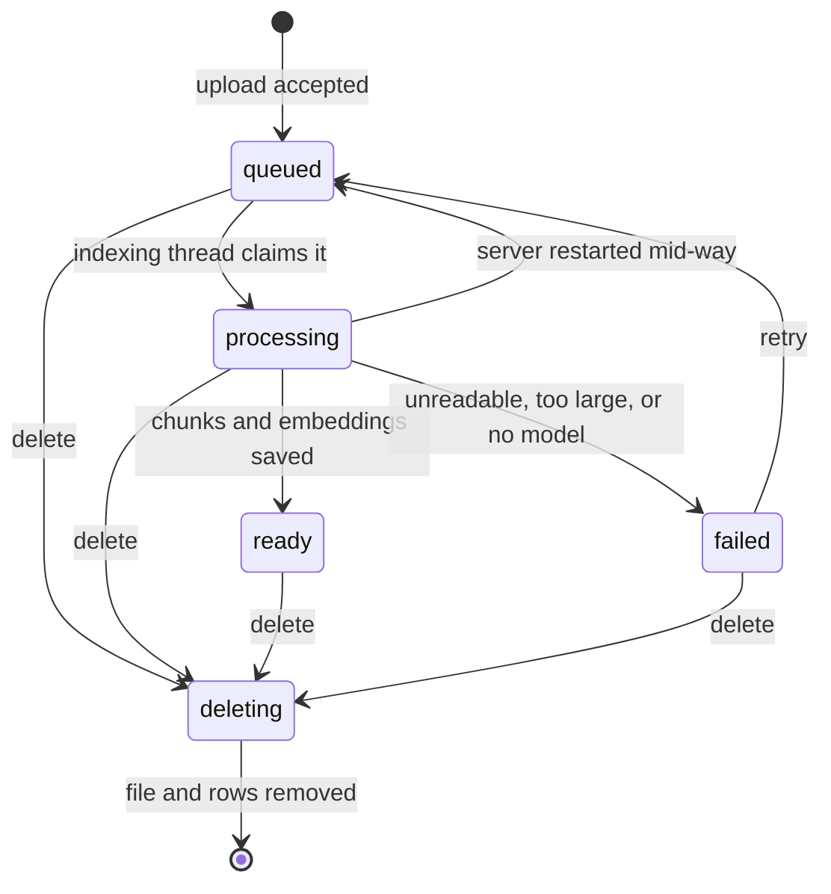
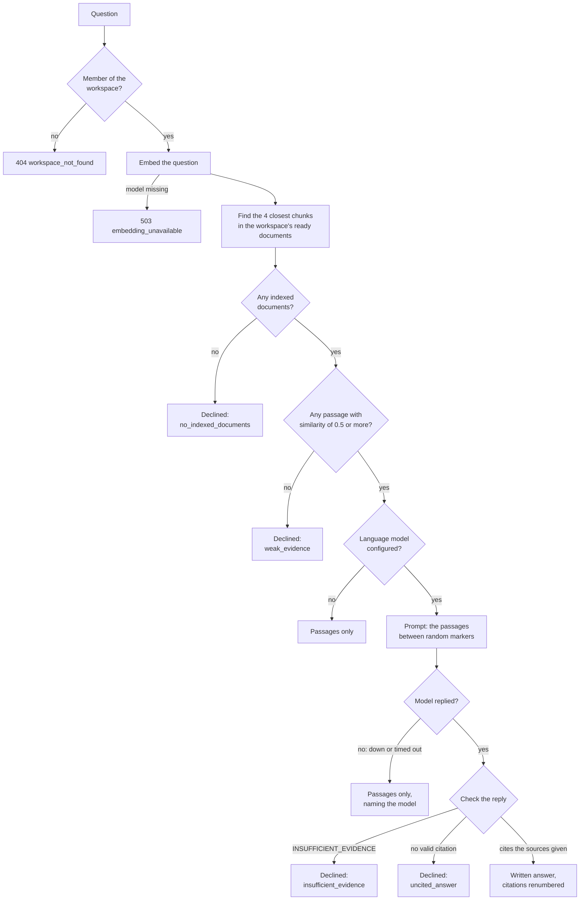
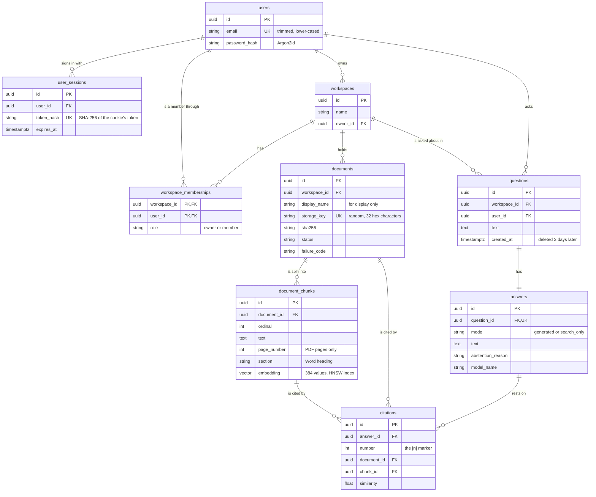

# Architecture

How the Evidence-backed Knowledge Assistant is built, as of Phase 6 (2026-10-31). The [specification](../specification/README.md#4-architecture-and-technology-decisions) records the design and the reasons for it. This page describes the code as it is, so a reviewer can find their way around it. Companion guides: [API](../api/README.md), [security](../security/README.md), and [operations](../operations/README.md).

## At a glance

- **One application, one process.** The backend is a modular monolith. The FastAPI app runs in a single uvicorn process with two background threads, one for indexing documents and one for deleting old questions. There are no separate services or message queues.
- **One database.** PostgreSQL 16 with the pgvector 0.8.0 extension holds the accounts, workspaces, documents, the text chunks with their embeddings, and the questions and answers. Vector search runs in the same database, in the same query that checks workspace membership.
- **Files on a volume.** Uploaded files are stored in a local folder under random names.
- **A static web app.** The React and TypeScript single-page app is built by Vite. In production nginx serves it; in development, Vite's dev server does.
- **Models on the server only.** The embedding model runs inside the API process, on the CPU. A language model is optional: Ollama runs outside the stack, and only the backend calls it, over HTTP.
- **The browser talks only to the API.** It never reaches the database, the stored files, or a model directly.

## Runtime view

The production-style stack, `compose.prod.yaml`, runs on one computer:

The two Compose stacks differ like this:

| | Development: `compose.yaml` | Production-style: `compose.prod.yaml` |
|---|---|---|
| Web app | Vite's dev server on `127.0.0.1:5173` | nginx serving the built files on `127.0.0.1:8080` |
| API | Published on `127.0.0.1:8000`. The browser calls it directly, and CORS allows `http://localhost:5173` | Not published. The browser reaches it through nginx, on the web app's own origin, so CORS allows no origins |
| Database | Published on `127.0.0.1:5432` | Not published |
| Migrations | The `migrate` service runs them, and the API starts only after they succeed | The same |
| Images | Development targets, with the test tools | Production targets, without test tools and run by a user without root rights. The migration, API, and web containers can't change their own files and have no Linux capabilities; the database runs the same pgvector image as in development |
| Logs | Text by default | JSON, one object per line |

Both stacks give the API the same settings, with production values where they differ, and CI checks that the two lists match. Running without containers is also supported ([quickstart](../specification/README.md#without-containers-no-administrator-rights)).

## Backend code layout

The backend is the `backend/app` package. Each folder is a layer, and imports go one way only:

| Folder or file | What it holds |
|---|---|
| `main.py`, `factory.py` | `create_app()` builds the app from settings: the database engine, the file storage, the embedding provider, the Ollama model when one is configured, the metrics, the two background threads, the middleware, the error handlers, and the routers. Tests call it with stand-ins, such as a fake embedder or a scripted model. |
| `api/` | HTTP. The routers for the health checks and for `/api/v1` (`auth`, `workspaces`, `documents`, `uploads`, `questions`), the Pydantic request and response models (`schemas.py`), and the dependencies in `deps.py`: the database session, the signed-in user, and the CSRF header check. |
| `services/` | The use cases: registering and signing in, workspaces, storing, retrying and deleting documents, indexing a document, and answering a question. Every service that touches workspace data checks membership itself. |
| `repositories/` | The SQLAlchemy queries, one module per group of tables. Every query that returns workspace data joins the memberships on the signed-in user. |
| `domain/` | Logic without I/O: file type and content checks, text normalization and chunking, prompt building and the citation check, and the status and reason enumerations. It imports nothing else from the app, so its tests need no database or model. |
| `providers/` | Adapters behind small interfaces: parsers (pypdf, python-docx, UTF-8 text), embeddings (Sentence Transformers), the language model (Ollama's chat API over HTTP), and file storage (a local folder). |
| `workers/` | The indexing thread, which runs the indexer the factory passes it, and the question cleanup thread. |
| `db/` | The SQLAlchemy table models, and helpers that create and empty the throwaway databases of the tests and the evaluation. |
| `core/` | Settings (pydantic-settings), the database engine, errors, logging, metrics, middleware, rate limits, and password hashing and session tokens. |
| `evaluation/` | The evaluation command: the corpus, the reviewed questions, the runner, the scoring, and the report ([evaluation](../evaluation/README.md)). |
| `cli.py` | `python -m app.cli` with four commands: `download-embedding-model`, `evaluate`, `compare-results`, and `write-demo-files`. |

The schema is created by Alembic migrations in `backend/alembic/versions`, `0001` to `0005`, never by the app.

## How a request is handled

1. **nginx**, in production, passes on `/api/` and `/health/`. It sets `X-Forwarded-For` to the address it received the request from, replacing any value the browser sent. Other paths are the web app's files.
2. **Middleware**, outermost first:
   - **Request ID:** gives each request a new random ID. The ID is returned in `X-Request-ID` and attached to every log line written during the request. IDs sent by the client are ignored.
   - **Access log:** one line per request, with the method, the route template rather than the actual path, the status, and the duration.
   - **CORS:** allows only the configured origins.
   - **Error fallback:** turns an unexpected exception into `500 internal_error`, in the usual error format.
   - **Body size limit:** refuses bodies over 64 KiB, apart from uploads, which have limits of their own.
3. **The `/api/v1` router** requires the header `X-CSRF-Protection: 1` on every POST and DELETE.
4. **Dependencies** open a database session and look up the user from the session cookie. Only registration, sign-in, and sign-out work without a signed-in user; every other endpoint under `/api/v1` answers 401 instead.
5. **The service** checks that the user is a member of the workspace. It answers 404 if not, so other users can't learn that a workspace exists. Then it does the work.
6. **Errors** raised as `AppError` become `{"error": {...}}` responses ([API guide](../api/README.md#errors)).

## Background work

### Indexing documents

An upload is stored and recorded as `queued`, and the upload wakes the indexing thread. When there's nothing to wake it, the thread checks for queued documents every 5 seconds. For each document, it:

1. Claims the oldest queued document with `SELECT … FOR UPDATE SKIP LOCKED`, marks it `processing`, and commits, so no transaction stays open while it works.
2. Reads the file and extracts its text: PDF page by page, Word section by section under each heading with tables as rows, and plain text whole. Limits on pages, characters, and parsing time apply.
3. Normalizes the text and splits it into chunks of about 1,000 characters, with 150 characters of overlap. A chunk ends at a paragraph, line, sentence, or word boundary where it can, and never spans two pages or sections.
4. Embeds the chunks on the CPU in batches of 32, with `BAAI/bge-small-en-v1.5` at a pinned revision, loaded from disk without a network.
5. Saves the chunks and marks the document `ready`, but only if it's still `processing`. A document that was deleted in the meantime stays deleted.

A document that fails is marked `failed`, with a code and a message saying what to do, and can be retried. When the API starts, documents left `processing` by a server that stopped mid-way are queued again.

Deleting marks the document `deleting`, and deletes the questions whose answers cite it, in one transaction. It then deletes the stored file, and last the document's row, which takes its chunks with it. If the file can't be deleted, the document stays visible as `deleting`, and deleting it again finishes the job.

### Deleting old questions

The cleanup thread runs when the API starts and then every hour. It deletes questions asked more than 3 days ago, with their answers and citations. The history already hides them once they're 3 days old, so the hour in between doesn't show.

### Why threads, and why one process

Indexing runs in a thread of the API process, and PostgreSQL acts as its queue. That keeps parsing and embedding out of the HTTP request without another service to run. The cost is that the backend must run as one process:

- the rate limits count requests in memory;
- each process would start its own threads;
- each process would load its own copy of the embedding model.

A durable queue and separate workers are deferred until there's a measured need ([specification §15](../specification/README.md#15-decisions-intentionally-deferred)).

## Answering a question

The [specification's sequence diagram](../specification/README.md#62-question-answering) shows the full exchange. These are the outcomes the code can reach:

- **No connection is held while models run.** The service ends its read transaction before embedding the question, and again before asking the model, which can take a minute or more.
- **Search is scoped in SQL.** One query joins the chunks to their documents and to the signed-in user's workspace memberships, keeps only `ready` documents, and orders by cosine distance through the HNSW index. The index is approximate, so a close chunk can occasionally be missed. Its strict-order iterative scan (`hnsw.iterative_scan = strict_order`) keeps searching past chunks from other workspaces, so the filter doesn't leave fewer than 4 results while enough exist, up to pgvector's scan limit.
- **Answers are checked before they're stored.** The citation check drops any citation of a source the model wasn't given, and renumbers the rest. Before the answer is stored, the cited documents are locked and checked again. If one was deleted in the meantime, the API answers `409 answer_sources_changed` and the user asks again.

The prompt, the markers, and the check are described in the [security guide](../security/README.md#documents-that-try-to-instruct-the-model).

## Data model

The diagram shows the main columns only; `backend/app/db/models.py` has them all. The database itself enforces several rules:

- `documents.status` is one of `queued`, `processing`, `ready`, `failed`, or `deleting`, and membership roles are `owner` or `member`.
- An answer has text only when a model wrote it and didn't decline, and a written answer records the model that wrote it.
- Deleting a workspace, a document, a question, or an answer deletes what depends on it (`ON DELETE CASCADE`).
- `document_chunks.embedding` is a `vector(384)` with an HNSW index for cosine distance. HNSW works on an empty table, unlike IVFFlat, which needs data before it is built.

Workspaces are single-user for now: the creator is the only member, with the `owner` role. The `member` role is reserved for sharing, which the membership table already allows for.

## Web app

- **Stack:** React 19 and TypeScript 5.8, built by Vite 6. There's no router or state library: the app is one page, and its state lives in React components.
- **`src/api/`:** one module per area of the API. `client.ts` sends every request with the session cookie (`credentials: "include"`) and adds `X-CSRF-Protection: 1` to every POST and DELETE. It turns error responses into an `ApiError` with the API's error code and request ID. `parse.ts` checks each response's shape before the app uses it.
- **`src/features/`:**
  - `auth`: sign-in, registration, and the service status line.
  - `workspaces`: the list, the create form, and a workspace's home.
  - `documents`: the upload queue, the library, and the download and delete buttons.
  - `questions`: the question box, the history, answers, and their sources.
- **Live status:** while any document is `queued` or `processing`, the library reloads the list every 2.5 seconds. Status changes are announced to screen readers.
- **Where it sends requests:** the production build uses `VITE_API_BASE_URL=/`, so it calls the API on its own origin, through nginx. In development it calls `http://localhost:8000`.
- **What it keeps:** nothing apart from the session cookie, which is HttpOnly so scripts can't read it. It uses no local storage, and loads no fonts, scripts, or analytics from other sites.

## Main design choices and their limits

| Choice | Why | Limit, and what would change it |
|---|---|---|
| A modular monolith in one process | One thing to run, test, and debug. The layers keep the code organized without network calls between services | It scales up, not out. More processes would need shared rate limits (for example, in Redis) and a separate indexing worker |
| PostgreSQL as the indexing queue | `FOR UPDATE SKIP LOCKED` is enough for one worker, and documents can't be lost between two systems | One document at a time. A durable queue is deferred until throughput needs it |
| pgvector in the main database | One store and one transaction for metadata and vectors. The membership check and the vector search are one query | Plain vector search only. Keyword or hybrid search and reranking are deferred until the evaluation shows a need |
| A small local embedding model, pinned to one revision | No per-call cost, results that can be repeated, and nothing sent to a third party | English-focused, and changing the model means indexing every document again |
| An optional local language model, with passages-only as the fallback | The app stays useful without a model or a GPU, and the evidence is always shown | Answers are slow on a CPU, and the model's quality limits the answers ([evaluation](../evaluation/README.md)) |
| Server-side sessions in an HttpOnly cookie, plus a CSRF header | Sessions can be revoked, and page scripts never see a token | The web app and the API must share a site, as they do behind nginx |
