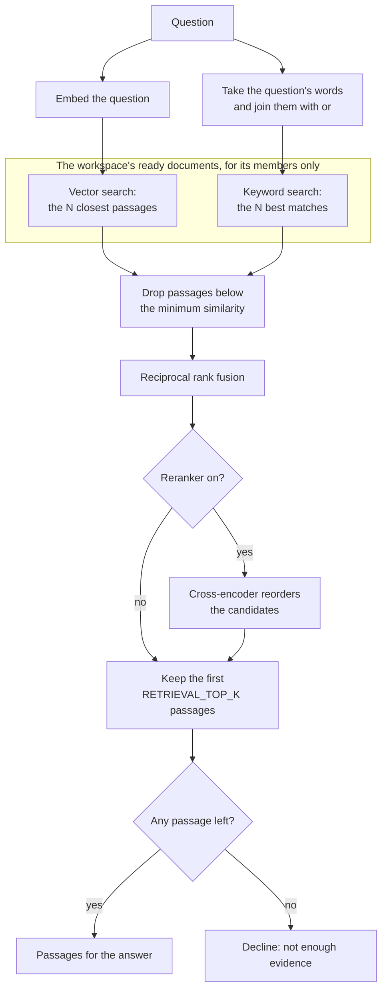
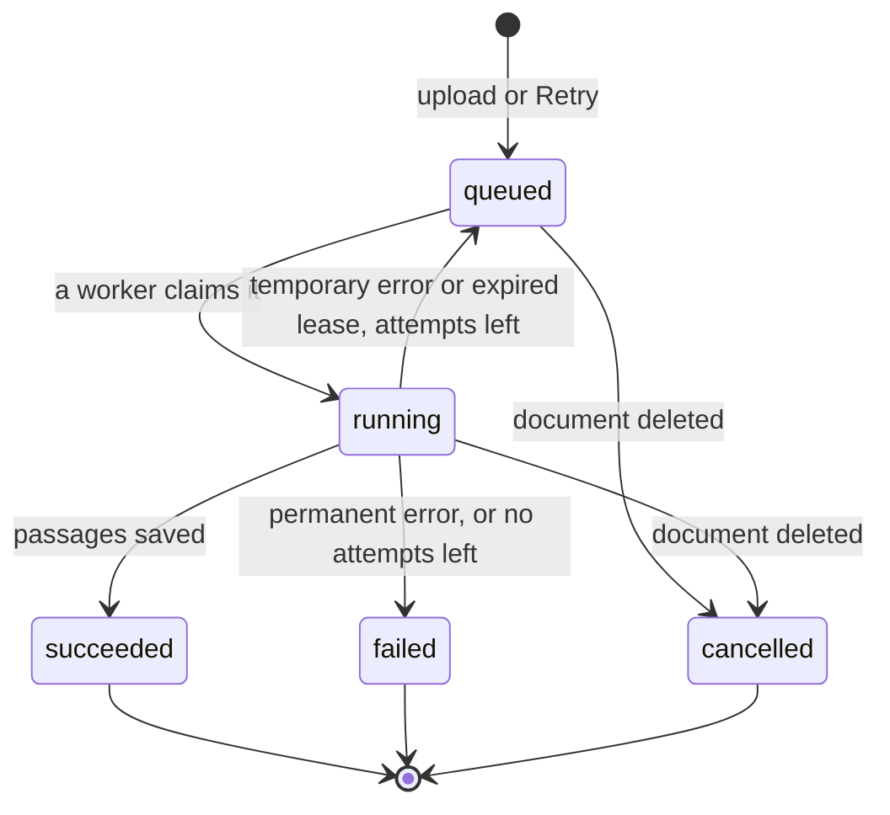
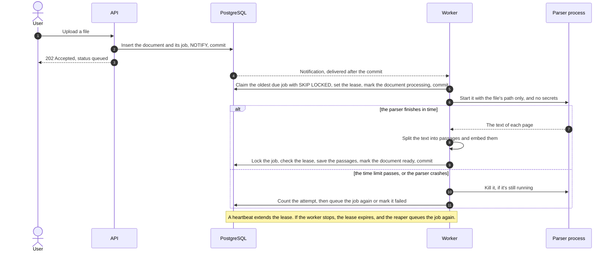
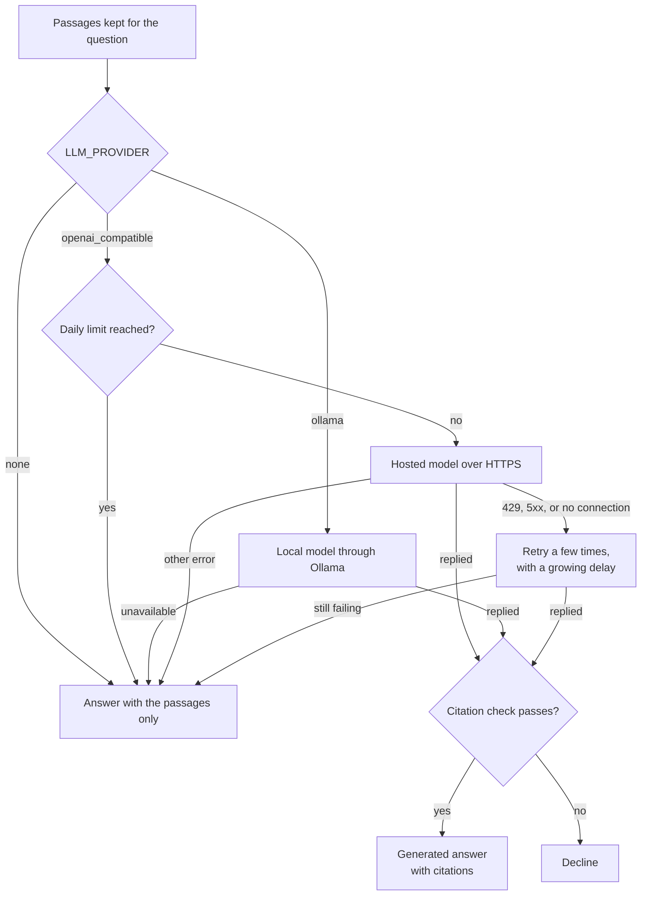
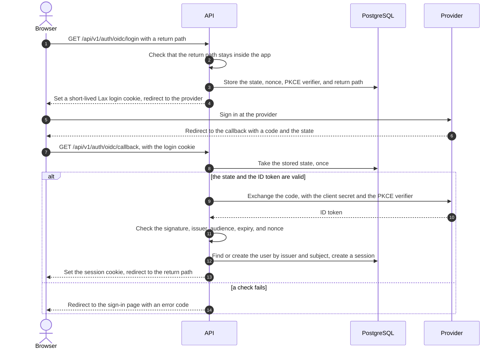

# Roadmap: later features

The plan for four features that the [specification](../specification/README.md#15-decisions-intentionally-deferred) left for later: hybrid search and reranking, a durable queue for indexing, a hosted language model, and sign-in through an OpenID Connect provider. It was written on 2026-10-31, after Phases 0 to 6. [Phase 7](#phase-7--hybrid-search-and-reranking) has since been built, but isn't finished, and **Phases 8 to 10 haven't been built yet**. The order, Phases 7 to 10, is the owner's choice (D-80). The tasks are in the [task tracker](../tracker/01-task-tracker.md), and the decisions and risks named here, such as PD-09 and R-27, are in [decisions, risks, and issues](../tracker/03-decisions-risks-issues.md).

> **This is a plan, not a result.** Each phase opens with a decision task that confirms or changes the design below. A feature that changes what users get, or adds a process or a cost, keeps today's behavior by default until a measurement, a test, or a review supports changing it. The plan promises no numbers: a result is reported only after it has been measured, with the conditions it was measured under.

## At a glance

| Phase | Feature | What it adds | Settles | Off by default | Remarks |
|---|---|---|---|---|---|
| 7 | Hybrid search and reranking | Keyword search next to the vector search, the two lists merged by reciprocal rank fusion, and an optional model that reorders the passages | PD-09 | Yes: `RETRIEVAL_MODE=vector` | Judged on new questions that no setting was chosen with |
| 8 | A durable queue for indexing | A `jobs` table in PostgreSQL with leases, attempts, and retries; parsing in a child process that can be stopped; an optional worker process | PD-08 | Partly: the queue replaces how documents are claimed, and `INDEXING_RUNNER=embedded` keeps a single process | PostgreSQL is the queue, so no new service is needed |
| 9 | A hosted language model | An adapter for OpenAI-compatible chat APIs, a daily limit on hosted calls, and a notice saying where questions go | PD-06 | Yes: `LLM_PROVIDER` stays `ollama` | No hosted call before the owner approves a vendor and its cost |
| 10 | Sign-in through a provider | Sign-in through one configured OpenID Connect provider, with the API as the client | PD-10 | Yes: `AUTH_MODE=local` | One provider per deployment, not enterprise single sign-on |

The order starts with the feature that has measured evidence behind it and needs nothing from outside this computer, and it ends with the one that changes the most security-sensitive code. No phase needs another one first, so the order can still change.

## How the phases are run

These rules apply to every phase. They follow the specification and the way Phases 0 to 6 were built.

- **Local and free first.** Each feature can be built and tried on this computer, without containers (D-31) and without paying for anything. The one exception is evaluating a hosted model, which waits until the owner approves a vendor and its cost (Phase 9).
- **One application.** The app stays a modular monolith. The only new process is Phase 8's optional indexing worker, which runs the same code. No Kafka, Redis, microservices, or Kubernetes.
- **Today's behavior by default.** A feature that changes what users get, or adds a process or a cost, comes with a setting whose default keeps the app as it is. A default changes only when an evaluation, a test, or a review supports it, and a decision records why.
- **No promised numbers.** This page expects no particular gain. Results are reported after they're measured, with their conditions, as on the [evaluation page](../evaluation/README.md).
- **Decide first, document last.** Each phase opens with a decision task (P7-01, P8-01, P9-01, and P10-01) and closes by updating the guides, the specification, and the tracker.
- **One branch per phase.** `phase7-hybrid-search`, `phase8-durable-queue`, `phase9-hosted-model`, and `phase10-oidc-sign-in`, like the branches of Phases 0 to 6. Nothing is pushed or merged without the owner's approval.
- **Synthetic data, no secrets.** Tests and evaluations use synthetic or public documents only. Keys and client secrets come from the environment and are never committed, logged, or returned by the API. Every new library and model has its license checked before it's added.

## Phase 7 — Hybrid search and reranking

Settles PD-09. Tasks: [Phase 7 in the task tracker](../tracker/01-task-tracker.md#phase-7--hybrid-search-and-reranking).

**Status on 2026-11-01: built and partly measured, not finished.** P7-01 fixed the design and the rule for choosing the default before any run (D-81): `ts_rank` rather than `ts_rank_cd`, 20 candidates from each search, and `cross-encoder/ms-marco-MiniLM-L6-v2`, the owner's choice, as the reranker. By that rule, `vector` stays the default (D-82): on the held-out set, `hybrid`'s kept passages stated every fact for 42 of the 44 questions with facts, as `vector`'s did. Still to do: measure `hybrid_rerank`, whose model couldn't be downloaded on the computer used (B-03); and, done since, the owner's approval of the held-out set, unchanged, after the runs used it (P7-02), and a run in CI, which passed on 2026-11-01. The reranker was trained on MS MARCO, whose terms allow non-commercial research use only; `BAAI/bge-reranker-base`, licensed MIT, is the untried alternative. The results are on the [evaluation page](../evaluation/README.md#search-modes-and-the-held-out-set-phase-7). The design below is the plan as written before the build.

### Why

In the evaluation of 2026-10-29, the 4 passages kept for each question stated every fact for 52 of the 54 questions with facts. For a09 and a10, the passages with the facts ranked 10th and 8th, so they weren't kept, and the model rightly declined both ([finding passages](../evaluation/README.md#finding-passages)). Keeping more passages isn't the fix: 5 or 6 found every fact for no more questions than 4 did, and more than 6 don't fit the prompt ([trade-offs](../evaluation/README.md#trade-offs)). The order of the passages has to improve. Searching by keywords as well as by meaning, and reranking, might improve it; this phase measures whether they do.

### Design

- **Keyword search.** A stored generated column on `document_chunks` holds `to_tsvector('english', text)`, which PostgreSQL keeps up to date, and a GIN index makes it fast to search ([tables and indexes](https://www.postgresql.org/docs/16/textsearch-tables.html)). The question is first reduced to its words, so quotes and dashes in it can't change the query. The words are joined with `or` and passed to `websearch_to_tsquery('english', …)`, which doesn't raise errors on what people type ([controlling text search](https://www.postgresql.org/docs/16/textsearch-controls.html)). So a passage matches if it contains any of the words, after stemming and without stop words. A question made only of stop words, such as "What is it?", matches nothing, and the vector search alone decides.
- **Keyword ranking.** `ts_rank_cd` ranks a passage higher the more often the question's words appear in it. Unlike BM25, the ranking that Elasticsearch and OpenSearch use by default, it doesn't give rare words more weight than common ones. Whether that matters here is one of the things the evaluation shows; P7-01 can choose `ts_rank` instead.
- **The same scope.** Both searches use the same filter: passages of the workspace's ready documents, for the workspace's members only. A passage from another workspace, or from a document that's still being indexed, can never be a candidate.
- **The evidence gate stays.** Every candidate gets its cosine similarity to the question, and those below the minimum (0.5) are dropped before fusion, in every mode. Today's search applies the same minimum, so declines stay comparable. The results record how many keyword matches the gate dropped, so P7-07 can see whether it undoes what keyword search found.
- **Fusion.** Each search returns its N best passages (`RETRIEVAL_CANDIDATES`, chosen at P7-01). Reciprocal rank fusion gives each passage the sum of 1 / (k + rank) over the lists it appears in, with k = 60, as in the paper that introduced it ([Cormack, Clarke, and Büttcher, 2009](https://doi.org/10.1145/1571941.1572114)). It uses only ranks, so the two searches' scores never need to be made comparable. It's a small pure function in `app/domain/`, with a fixed order for ties.
- **Reranking, optional.** A cross-encoder reads the question and a passage together and scores how well they match. That takes more time per passage than comparing two embeddings, so it runs only on the fused candidates. It sits behind a `Reranker` interface in `app/providers/rerankers.py`, like the embedding provider, and runs on the CPU. The candidates are `cross-encoder/ms-marco-MiniLM-L6-v2` (Apache-2.0, English) and `BAAI/bge-reranker-base` (MIT, English and Chinese, from the makers of the embedding model). The chosen model is pinned to a revision and downloaded ahead of time by the CLI, as `download-embedding-model` does for the embedding model. If it fails to load or run, the fused order is used, and the failure is logged and counted, so the reranker can never stop a question from being answered.
- **The prompt doesn't change.** The kept passages reach the model with the same labels and limits in every mode.

| Setting | Values | Default | Remarks |
|---|---|---|---|
| `RETRIEVAL_MODE` | `vector`, `hybrid`, or `hybrid_rerank` | `vector` | `vector` is today's search |
| `RETRIEVAL_CANDIDATES` | How many passages each search returns before fusion | Set at P7-01 | More candidates cost more time, mostly in reranking |
| `RRF_K` | The k in 1 / (k + rank) | 60 | As in the paper |
| `RERANKER_MODEL_NAME` and `RERANKER_MODEL_REVISION` | A Hugging Face model and the commit to use | Set at P7-01 | Read only in `hybrid_rerank` mode |

`RETRIEVAL_TOP_K` (4) and `RETRIEVAL_MIN_SIMILARITY` (0.5) keep their meaning and their values.

In `vector` mode, today's path, only the vector search runs, and there's no fusion or reranking.

### Evaluation

The 66 questions chose today's settings (D-67), and the two misses are known, so a mode tuned on those questions would look better than it is (R-27). So the evaluation works like this:

1. **A held-out set, written first (P7-02).** New synthetic documents and questions, in the format the evaluation already uses ([adding questions or documents](../evaluation/README.md#adding-questions-or-documents)), in a folder of their own, such as `evals/held-out/`. The owner reviews them, and they're frozen before any Phase 7 mode runs on them.
2. **A rule fixed before any run (P7-01).** The main measure is the number of held-out questions with facts whose kept passages state every fact. The guardrails: questions without facts are declined at least as often as with `vector`, and the median and longest time per question stay within a budget that P7-01 sets. A tie, a difference smaller than a margin that P7-01 sets, or a broken guardrail keeps `vector`.
3. **Every mode, both sets.** Each mode runs search-only on the 66 questions and on the held-out set, with one results file per run, and the chosen mode runs again with the local model. The results are reported with their conditions, as on the [evaluation page](../evaluation/README.md), and they also record the reranker's scores, for later decisions. However it ends, the result holds for these small synthetic sets only ([limits](../evaluation/README.md#limits)).
4. **A first independent check of today's settings.** The held-out set also shows how the 4 passages and the 0.5 minimum, chosen with the 66 questions, do on questions that didn't choose them. Changing them stays deferred, because tuning them on the held-out set would use it up.
5. **CI keeps the default.** CI's evaluation step keeps running the default mode and comparing it with the committed results.

### Tests

- **Unit:** reciprocal rank fusion (ties, empty lists, a passage in only one list), the step from a question to a keyword query (quotes, dashes, punctuation, only stop words, accented letters), and the reranker's fallback, with a stand-in model.
- **Integration, with PostgreSQL:** the migration adds and removes the column and its index; keyword search finds a passage by a word that appears only there; workspace isolation and ready-only documents hold in every mode.
- **Robustness:** the existing robustness tests run in every mode.

### Other options

| Option | Why not now | Remarks |
|---|---|---|
| Elasticsearch or OpenSearch | A second data store to run, keep in sync, and secure, for a few documents | PostgreSQL's full-text search is enough to test the idea |
| ParadeDB's `pg_search`, BM25 inside PostgreSQL | AGPL-3.0 license, and the extension isn't installed on this computer or in CI | BM25 gives rare words more weight, which `ts_rank_cd` doesn't |
| Learned sparse vectors, such as SPLADE, in pgvector's `sparsevec` | One more model to run, and one more vector per passage | pgvector supports it, if keyword search isn't enough |
| Tuning the HNSW index | On the evaluation's 22 passages, the index found the same passages as an exact search (V-149) | R-21 stays open for larger collections |
| Keeping more passages | 5 or 6 didn't find more facts, and more than 6 don't fit the prompt | See [trade-offs](../evaluation/README.md#trade-offs) |

### Risks

- **R-27, new: tuning to a small evaluation.** Reduced by the held-out set, the rule fixed before the runs, the margin, and reporting both sets.
- **English only.** The `english` text-search configuration stems English words, so documents in other languages would get poor keyword matches. The embedding model is English too.
- **R-20.** The reranker is one more model that CI downloads.
- **R-21 and R-22** stay as they are: this phase changes neither the index nor the gate.

### Done when

- Every mode has been measured on both question sets, and the results, with their conditions, are committed.
- The default has been chosen by the rule fixed at P7-01 and recorded as a decision. Keeping `vector` is a valid result.
- The tests pass locally and in CI, and the evaluation, architecture, and operations guides and the specification describe what was built.

Not in this phase: tuning the HNSW index, another embedding model, languages other than English, and changing the number of passages or the minimum similarity.

## Phase 8 — A durable queue for indexing

Settles PD-08. Tasks: [Phase 8 in the task tracker](../tracker/01-task-tracker.md#phase-8--a-durable-queue-for-indexing).

### Why

Today a thread inside the API indexes documents one at a time ([background work](../architecture/README.md#background-work), D-45). It claims the oldest queued document with `FOR UPDATE SKIP LOCKED`, and it's woken when a file is uploaded, or checks again every 5 seconds. That's enough for one person on one computer, but it has gaps:

| Gap | What can happen | Remarks |
|---|---|---|
| No lease | A document stays `processing` until the thread finishes with it. If the API stops, only its next start queues the document again | D-45 |
| No count of attempts | A file that crashes the API is tried again at every start | Nothing ends the loop |
| Parsing can't be stopped | Text is extracted inside the API process, so a slow page can run past the time limit, and a crafted file can use a lot of memory | R-19. The endless loop fixed in pypdf 6.21.4 (I-42) was this kind of problem |
| Shared resources | Indexing takes the API's CPU time and memory while people ask questions | Embedding runs on the CPU |
| No automatic retry | A temporary failure leaves the document `failed` until the user selects Retry | The user sees the failure's code |

### Design

The work is held in a `jobs` table in PostgreSQL:

| Column | Holds | Remarks |
|---|---|---|
| `id` | The job's ID | A UUID, like the other tables |
| `kind` | What to do: `index_document` | The only kind at first |
| `payload` | The IDs the job needs, as JSON | Never file contents, document text, or secrets |
| `status` | `queued`, `running`, `succeeded`, `failed`, or `cancelled` | The document keeps its own status for users |
| `run_after` | The earliest time the job may run | Delays retries |
| `attempts` and `max_attempts` | How many times the job has started, and the limit | A crash or a timeout counts |
| `locked_by` and `locked_until` | The worker that holds the job, and until when | The lease |
| `dedupe_key` | For example, `index_document:` and the document's ID | Unique among unfinished jobs, so the same work is never queued twice |
| `last_error_code` | The code of the last failure | A code, never a message with document text |
| `created_at` and `updated_at` | When the job was queued and last changed | For metrics and cleanup |

- **Claiming.** A worker takes the oldest due job with one `UPDATE … RETURNING`, whose subquery locks the job with `FOR UPDATE SKIP LOCKED`, as the indexing thread does today. The same statement sets the lease and counts the attempt, and the worker commits before it starts the work. Two workers never get the same job.
- **Leases and fencing.** A heartbeat extends `locked_until` while the work runs. The worker saves the passages and finishes the job in one transaction, which first locks the job's row and checks that the worker still holds the lease. If it doesn't, the work is thrown away, so a worker that was too slow can't overwrite one that took over. A reaper queues jobs with an expired lease again, or fails them when no attempts are left. It replaces today's requeue at start.
- **Retries.** A temporary error queues the job again after a delay that grows with each attempt, with a random part (jitter) so retries don't arrive together. A permanent error, such as a file that can't be read, fails the job at once. P8-01 decides which failure codes are temporary.
- **Queuing in the same transaction.** An upload or a Retry inserts the job and sends `NOTIFY` in the transaction that changes the document. PostgreSQL delivers the notification only if that transaction commits ([NOTIFY](https://www.postgresql.org/docs/16/sql-notify.html)), so there's never a job without its document, or a wake-up for work that was rolled back. Deleting a document cancels its unfinished jobs in the same transaction.
- **What users see doesn't change.** A document is still `queued` while its job waits, including between retries, and `processing` while it runs, and then it's `ready`, or `failed` with a code.
- **Parsing in a child process.** The worker runs the parser as a separate Python process, started with `subprocess`. The child gets only the stored file's path and a minimal environment, without `DATABASE_URL` or any other secret, and sends back the text of each page. At the time limit, the worker kills it. On Linux, including in containers, the child also gets a memory limit; Python's standard library has no equivalent on Windows. A fresh process shares nothing with the worker, which also keeps database connections out of it: psycopg's connections "are not process-safe" ([concurrent operations](https://www.psycopg.org/psycopg3/docs/advanced/async.html#concurrent-operations)).
- **The worker.** `python -m app.worker` loads the embedding model and waits for jobs. It runs `LISTEN` on a connection of its own, in autocommit mode, so an open transaction never holds a notification back ([notifications](https://www.psycopg.org/psycopg3/docs/advanced/async.html#asynchronous-notifications)). It also checks the table every few seconds, because a notification sent while no one is listening is lost. With `INDEXING_RUNNER=embedded`, the default at first, the same loop runs in a thread inside the API, so one process is still enough on this computer. With `worker`, indexing and the hourly cleanup move to the worker process. The worker loads its own copy of the embedding model, so P8-05 measures the memory the two processes use.
- **The API stays one process,** so its in-memory rate limits still hold.
- **Metrics.** When `/metrics` is read, the API counts jobs by status and reports the age of the oldest queued job, from the `jobs` table, so the worker needs no port of its own.
- **Compose and CI.** Compose gets a `worker` service built from the backend image, and CI's compose smoke and end-to-end jobs run with it. On this computer, the app still runs without containers (D-31).

A job's states. The document's own status, which users see, follows them.

### Tests

- Two workers claiming at once never get the same job.
- An expired lease lets another worker take the job, and the first worker's late save is refused.
- A job stops after `max_attempts`, and a permanent error fails it at once.
- Queuing the same document twice gives one unfinished job.
- A rolled-back upload leaves no job and wakes no worker.
- A parser that hangs is killed at the time limit, and one that exits abruptly (`os._exit`) counts as an attempt.
- Deleting a document cancels its job.
- By hand: killing the worker while it indexes, then checking that every document ends `ready` or `failed`, with no passage saved twice.

### Other options

| Option | Why not now | Remarks |
|---|---|---|
| procrastinate, a PostgreSQL task queue for Python (MIT) | Less code to write, but it brings its own tables, worker, and conventions, more than one kind of job needs | P8-01 can still choose it |
| Celery or RQ, with Redis | A second service to run and secure, against the local-first rule | Common in larger Python apps |
| A cloud queue | Needs a cloud account, and the cloud is deferred (PD-07) | Possible after a deployment decision |
| Kafka | The specification adds it only for a measured need, and one kind of job isn't one | Built for far larger streams of events |
| The smallest fix: a lease and an attempt count on the document, kept in the API's thread | Least code, and parsing could still move to a child process | P8-01 chooses it if the `jobs` table isn't worth its code |

### Risks

- **R-19** is the risk this phase reduces: once parsing runs in a child process that can be killed, R-19 can be closed.
- **Memory.** Two processes each load the embedding model. P8-05 measures it before the worker becomes the default anywhere.
- **R-24** doesn't change: questions are still answered within the request.

### Done when

- Killing the worker while it indexes loses no document and saves no passage twice.
- A parser that hangs or crashes can't keep other documents waiting.
- The queue's depth and its oldest job's age are in `/metrics`, and Compose and CI run the worker.
- The architecture, operations, and security guides and the specification describe what was built.

Not in this phase: Redis or another message broker, answering questions through the queue (R-24), and kinds of jobs other than indexing.

## Phase 9 — A hosted language model

Settles PD-06. Tasks: [Phase 9 in the task tracker](../tracker/01-task-tracker.md#phase-9--a-hosted-language-model).

### Why

The local model, through Ollama, stays the default. A hosted model would let the app write answers on a computer that can't run a local one, and it would test whether the `LanguageModel` interface really keeps the provider replaceable. It also brings two things a local model doesn't: questions and passages leave the computer, and each answer costs money. This phase plans for both.

### Design

- **One adapter for many providers.** `OpenAICompatibleChatModel`, next to `OllamaChatModel` in `app/providers/llm.py`, implements the same `LanguageModel` interface. It calls the Chat Completions endpoint that many providers offer, with `urllib`, like the Ollama adapter, so it needs no new dependency. It's developed and tested against Ollama's own OpenAI-compatible endpoint on this computer, which needs a key but ignores it ([OpenAI compatibility](https://docs.ollama.com/api/openai-compatibility)), so building it needs no hosted account.
- **The same request as today.** The same instructions and source labels (S1, S2, and so on), temperature 0, no tools or functions, and the same 768-token cap on the answer. Some providers call that cap `max_tokens` and others `max_completion_tokens`; P9-01 checks the chosen one. A reply over 1 MiB is refused, as now, and the same citation check decides whether the answer is shown or declined.
- **Errors.** A 429, a 5xx, or a lost connection is retried a few times, with a growing delay, following `Retry-After` when it fits in the 120 s timeout. 400, 401, 403, and 404 aren't retried. If no answer comes, the app shows the passages, as it does when Ollama isn't running. The request, the reply, and the key are never logged.
- **What leaves the computer.** The instructions, the question, and the passages kept for it, at most 6,000 characters, labeled S1, S2, and so on. Never files, document names or IDs, email addresses, or anything else about the account. The [privacy page](../privacy/README.md#what-leaves-your-computer) will say so.
- **Saying where answers come from.** A new `answers.model_provider` column records which provider wrote each answer, and the answer says so. When a hosted provider is set, the web app says, next to the question box and before anything is sent, that questions and passages go to that provider.
- **Cost.** `LLM_DAILY_CALL_LIMIT` caps hosted calls per day. The count is kept in PostgreSQL, so a restart doesn't reset it. Past the limit, answers fall back to the passages, with a note. The token counts in each reply become metrics. If the vendor offers budget alerts, they're set before the first call.
- **Decided at P9-01:** the vendor and model, after reading its terms on how it uses and keeps requests; an estimate of what the evaluation and normal use would cost; whether to use the vendor's SDK instead of `urllib`, which would add a dependency and an HTTP client that must work with this computer's certificate setup (R-16); and the owner's approval.

| Setting | Meaning | Default | Remarks |
|---|---|---|---|
| `LLM_PROVIDER` | `ollama`, `openai_compatible`, or `none` | `ollama`, as today | `openai_compatible` is new |
| `LLM_BASE_URL` | The provider's API address | Not set; required with `openai_compatible` | Must use HTTPS unless it points at this computer |
| `LLM_MODEL` | The model's name at the provider | Not set; required with `openai_compatible` | Chosen at P9-01 |
| `LLM_API_KEY` | The provider's key | Not set | A secret: never logged, returned, or committed |
| `LLM_DAILY_CALL_LIMIT` | Hosted calls allowed per day | Set at P9-01 | Counted in PostgreSQL |

From the passages to the answer. `none` and `ollama` work as they do today.

### Tests

- A fake OpenAI-compatible server inside the tests: normal replies, 429 with `Retry-After`, 5xx, timeouts, replies that are too large or aren't JSON, and a check that neither the key nor any text reaches the logs.
- The same adapter against Ollama's OpenAI-compatible endpoint, by hand, on this computer.
- Web tests for the notice, and for the provider's name on answers.
- No key in CI, and no hosted call in any automated test.

### Other options

| Option | Why not now | Remarks |
|---|---|---|
| A vendor's SDK | Another dependency and HTTP client, for one endpoint | P9-01 decides |
| A gateway that talks to many providers, run as its own service | One more service to run, for one adapter's work | The adapter already speaks the common format |
| Hosted embeddings | Every document's text would leave the computer, not just the passages for a question | The local embedding model stays |

### Risks

- **R-28, new: sending text to a third party.** Questions and passages could be kept or used under the vendor's terms, and costs could grow. Reduced by keeping the local default, the notice, synthetic documents for the evaluation, the daily limit, and reading the terms at P9-01.
- **R-23** applies to hosted reasoning models too: they could spend the 768-token budget on thinking.
- **R-24.** A slow provider holds an API thread for up to the timeout, as a slow local model does.

### Done when

- The adapter passes its tests against the fake server and works with Ollama's OpenAI-compatible endpoint.
- Every answer records its provider, and the web app says where questions go before any is sent.
- If the owner approved a vendor, the evaluation has run with it, and its results name the vendor, the model, and the date. Without approval, the phase ends without a hosted run.
- The privacy, operations, and architecture guides and the specification describe what was built.

Not in this phase: streamed answers, tools or function calling, hosted embeddings, and more than one hosted provider at a time.

## Phase 10 — Sign-in through an OpenID Connect provider

Settles PD-10. Tasks: [Phase 10 in the task tracker](../tracker/01-task-tracker.md#phase-10--sign-in-through-an-openid-connect-provider).

### Why

Today every account is local: an email address and a password hashed with Argon2id, with no email verification, password reset, or second factor ([known gaps](../security/README.md#known-gaps)). Signing in through an identity provider leaves those to a system built for them, and the app stores no password for those users. The [specification](../specification/README.md#non-goals-for-the-mvp) lists multi-tenant enterprise single sign-on as a non-goal, so this phase supports one provider, configured for one deployment, such as a Keycloak server.

### Design

- **The API is the client.** The API runs the OpenID Connect authorization code flow itself, with its client secret, so the browser never holds the provider's tokens. The code passes through the browser, as in every code flow, but it's useless without the secret and the PKCE verifier. After sign-in, the user gets the same `eka_session` cookie as with a password ([signing in](../api/README.md#signing-in)), so nothing after sign-in changes.
- **Starting.** `GET /api/v1/auth/oidc/login?return_to=…` accepts only a path inside the app as the return address. Anything starting with `//` or `/\`, containing a backslash, or with a scheme is refused, so the app can't be used to send people elsewhere. The API stores a random state, a nonce, a PKCE verifier (S256), and the return path, under the hash of a token in a short-lived, HttpOnly login cookie. That cookie is `SameSite=Lax`, because the provider sends the browser back with a cross-site navigation, which doesn't carry `Strict` cookies.
- **Coming back.** `GET /api/v1/auth/oidc/callback` takes the stored state once, and only before it expires. It exchanges the code with the client secret and the verifier, and checks the ID token as OpenID Connect Core requires ([§3.1.3.7](https://openid.net/specs/openid-connect-core-1_0.html#IDTokenValidation)): the signature, with the provider's published keys, cached and fetched again once for an unknown key; an allowed algorithm, never `none` or a shared-secret one; the issuer; the audience and the authorized party; the expiry and issue time, with a small leeway; and the nonce. The API then finds or creates the user by issuer and subject, starts a normal session, and redirects to the return path. Any failure redirects to the sign-in page with an error code and no details.
- **Forged requests.** These two routes are top-level navigations, which can't carry the API's `X-CSRF-Protection` header. The state, tied to the browser by the login cookie, protects them instead, including against signing someone in to an attacker's account.
- **Current advice.** The flow follows RFC 9700, OAuth's current security best practice: redirect addresses matched exactly, PKCE even for a client with a secret, and no implicit flow ([RFC 9700](https://www.rfc-editor.org/rfc/rfc9700)).
- **What's kept.** The provider's addresses come from its discovery document, whose issuer must match `OIDC_ISSUER`. The app keeps no provider tokens, only the issuer and the subject. Signing out ends the app's session; whether it also signs out at the provider is decided at P10-01. What a user can see is still decided by workspace membership in the app, never by the provider's groups or roles.
- **Rate limits and cleanup.** The new routes are rate-limited like the other sign-in routes, and unused login states expire and are removed by the cleanup.
- **Accounts.**
  - A new `user_identities` table links a user to an issuer and a subject, unique together.
  - `users.password_hash` becomes optional, for users who sign in only through the provider. Password sign-in refuses an account without a password.
  - Accounts are never linked by email. If the provider's email belongs to an existing account, sign-in is refused with a clear message, because neither side's email may be verified. A signed-in user can link a provider to their own account.
  - How an account created through the provider gets its email, given that `users.email` is unique, is decided at P10-02.
  - Switching an existing install to `oidc` mode locks out local accounts without a linked provider; the operations guide will say so.
- **Library.** A maintained library checks the tokens: Authlib (BSD-3-Clause), or PyJWT (MIT) with its key-set client, or joserfc (BSD-3-Clause). P10-01 chooses. No cryptography is written by hand.
- **The web app.** When the mode allows it, the sign-in page shows a "Sign in with" button named by `OIDC_PROVIDER_NAME`, and it explains a failed sign-in in plain words.

| Setting | Meaning | Default | Remarks |
|---|---|---|---|
| `AUTH_MODE` | `local`, `oidc`, or `both` | `local` | `local` is today's sign-in |
| `OIDC_ISSUER` | The provider's issuer URL | Not set; required unless `local` | Must match the discovery document |
| `OIDC_CLIENT_ID` and `OIDC_CLIENT_SECRET` | The app's registration at the provider | Not set; required unless `local` | The secret is never logged, returned, or committed |
| `OIDC_REDIRECT_URI` | The callback's full address | Not set; required unless `local` | Must match the registered one exactly |
| `OIDC_SCOPES` | What the app asks the provider for | `openid email profile` | `openid` is always included |
| `OIDC_PROVIDER_NAME` | The name on the button | Not set; required unless `local` | Shown to users |

### Tests

- A fake provider inside the tests, with its own keys and discovery document, and tokens that must be refused: a bad signature, `alg` set to `none`, the wrong issuer or audience, an expired token, the wrong nonce, a reused or unknown state, and an unknown key.
- Return paths that try to send the browser elsewhere.
- The account rules: the same subject signs in to the same account, an email that's already used is refused, and password sign-in to an account without a password is refused.
- End to end in CI: Keycloak (Apache-2.0) in a container, with a synthetic realm and user, and a browser test through the whole flow. It also shows whether the browser sends the `Strict` session cookie after coming back from the provider, which hasn't been tried yet.
- On this computer, Keycloak can run from its zip with `bin\kc.bat start-dev`, which needs Java ([getting started](https://www.keycloak.org/getting-started/getting-started-zip)). This hasn't been tried yet either.
- A security review (P10-06) against RFC 9700 and OpenID Connect Core, recorded in the security guide.

### Other options

| Option | Why not now | Remarks |
|---|---|---|
| The browser as the client, holding the tokens | Tokens in the browser can be stolen by any script that runs on the page | The API as the client keeps them on the server |
| GitHub sign-in | GitHub's sign-in for apps is OAuth 2.0, not OpenID Connect, so it needs code of its own | A standard provider covers many services |
| Writing the token checks by hand | Easy to get subtly wrong | A maintained library does it |
| Several providers at once, or one per workspace | The specification lists multi-tenant enterprise single sign-on as a non-goal | One provider per deployment |

### Risks

- **R-29, new: a mistake in sign-in.** A misconfiguration, or a wrong rule for linking accounts, could let someone into another person's account. Reduced by a library for the token checks, no linking by email, the refusal tests, and the security review.
- **R-26.** Real use needs HTTPS, for the redirect address too.
- **Availability.** If the provider is down, its users can't sign in; local accounts still work in `both` mode. The provider is chosen when the app is deployed.

### Done when

- Sign-in through Keycloak works end to end in CI, including the session cookie after the redirect back.
- Every refusal case is refused, and the security review's findings are fixed or recorded.
- Password sign-in still works in `local` and `both` modes.
- The security, privacy, API, and operations guides and the specification describe what was built.

Not in this phase: several providers at once, roles or groups from the provider, provisioning users from the provider (SCIM), single sign-on across organizations, and linking accounts by email.

## What stays deferred

| Item | Why it stays deferred | Remarks |
|---|---|---|
| A cloud deployment | No cost estimate yet, and the owner prefers to keep everything local | PD-07, P6-05, and P6-06 |
| Replacing the default local model | Only if an evaluation shows that another model is needed | [Specification §15](../specification/README.md#15-decisions-intentionally-deferred) |
| Answering outside the request, or streaming answers | Only if waiting for the model is seen to hold up the API (R-24) | Phase 8's queue could carry it later |
| Changing the number of passages or the minimum similarity | Needs questions that weren't used to choose them | Phase 7's held-out set checks them without tuning them |
| Running the app in containers on this computer | The owner develops without containers (D-31) | Compose runs in CI |
| A shared store for rate limits | The API stays one process | Needed only with several API processes |
| The other known gaps, such as OCR, malware scanning, and deleting accounts and workspaces | Outside these four features | Listed in the [security guide](../security/README.md#known-gaps) |

## References

Licenses and versions were checked on 2026-10-31, and each phase's decision task checks them again.

- Cormack, Clarke, and Büttcher, "Reciprocal rank fusion outperforms Condorcet and individual rank learning methods", SIGIR 2009, pages 758–759: [doi.org/10.1145/1571941.1572114](https://doi.org/10.1145/1571941.1572114).
- PostgreSQL 16: [tables and indexes for text search](https://www.postgresql.org/docs/16/textsearch-tables.html), [controlling text search](https://www.postgresql.org/docs/16/textsearch-controls.html), and [NOTIFY](https://www.postgresql.org/docs/16/sql-notify.html).
- pgvector: [hybrid search](https://github.com/pgvector/pgvector#hybrid-search).
- psycopg 3: [concurrent operations and notifications](https://www.psycopg.org/psycopg3/docs/advanced/async.html).
- Hugging Face: [cross-encoder/ms-marco-MiniLM-L6-v2](https://huggingface.co/cross-encoder/ms-marco-MiniLM-L6-v2) and [BAAI/bge-reranker-base](https://huggingface.co/BAAI/bge-reranker-base).
- Ollama: [OpenAI compatibility](https://docs.ollama.com/api/openai-compatibility).
- [OpenID Connect Core 1.0](https://openid.net/specs/openid-connect-core-1_0.html), section 3.1.3.7, ID token validation.
- [RFC 9700](https://www.rfc-editor.org/rfc/rfc9700), Best Current Practice for OAuth 2.0 Security (January 2025).
- [RFC 7636](https://www.rfc-editor.org/rfc/rfc7636), Proof Key for Code Exchange by OAuth Public Clients (PKCE).
- Keycloak: [getting started with the zip](https://www.keycloak.org/getting-started/getting-started-zip).
- PyPI: [Authlib](https://pypi.org/project/Authlib/), [PyJWT](https://pypi.org/project/PyJWT/), [joserfc](https://pypi.org/project/joserfc/), and [procrastinate](https://pypi.org/project/procrastinate/).
- [ParadeDB](https://github.com/paradedb/paradedb), for `pg_search`.
