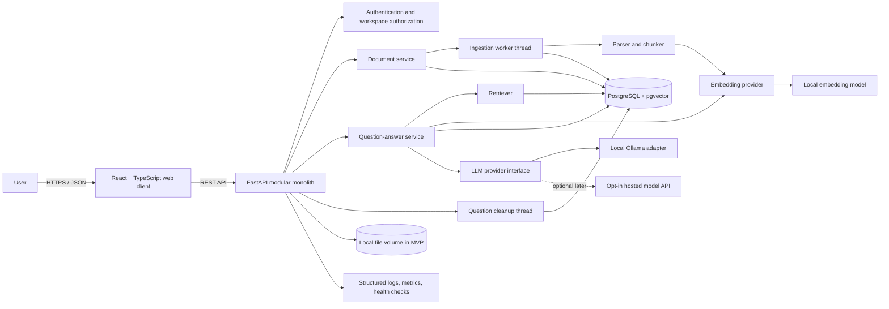
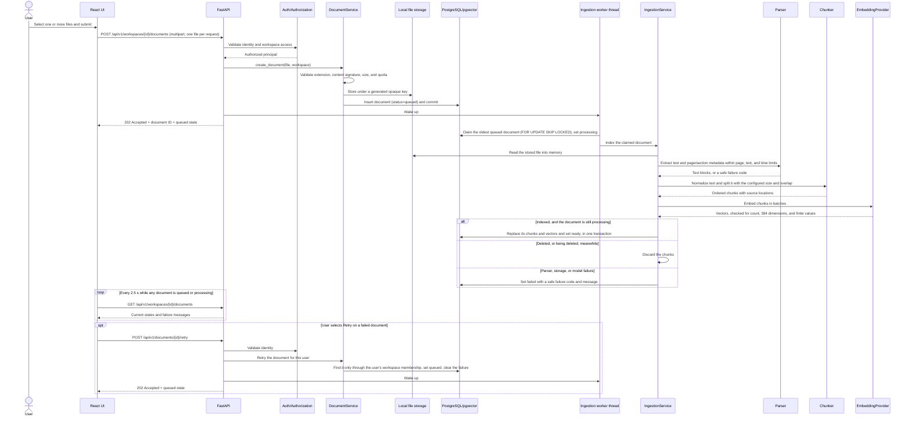
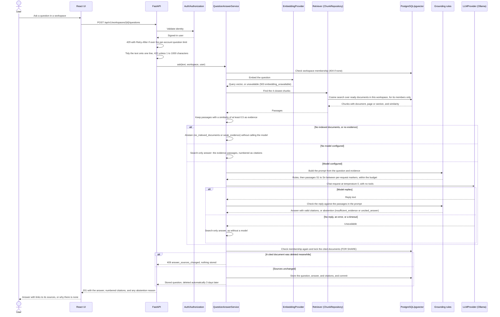
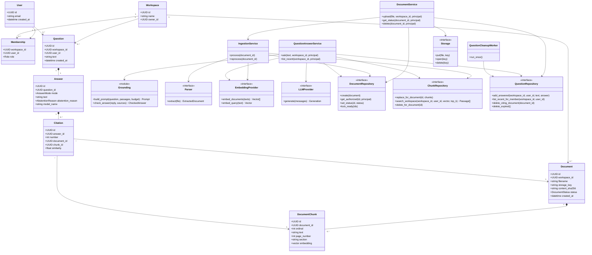

# Project specification: Evidence-backed Knowledge Assistant

**Status:** Build specification  
**Target role alignment:** Backend / platform / applied-AI engineer (UK, Germany, Netherlands, France)  
**Project type:** Portfolio-grade modular monolith; local-first, cloud deployment optional  
**Core rule:** This is an information-retrieval and summarization tool, not a source of professional, legal, medical, or financial advice.

## 1. Executive summary

Build a web application that lets a signed-in user create a private knowledge workspace, upload documents they are authorized to use, ask natural-language questions, and receive concise answers grounded in those documents. Every factual answer should cite the source document and page or section where available. If the retrieved material does not support an answer, the assistant should say it cannot find sufficient evidence rather than inventing an answer.

The portfolio goal is to turn the existing enterprise knowledge-assistant experience into a demonstrable, documented service with a Python API, React/TypeScript client, PostgreSQL/pgvector, repeatable tests, containerized local development, CI, and an optional cloud deployment. Start as one deployable application with clear module boundaries; do not add microservices, Kafka, Kubernetes, or paid cloud dependencies to the MVP without a measured need.

## 2. Goals and non-goals

### Goals

- Upload, list, inspect, and delete documents within a user's workspace.
- Support PDF, DOCX, and TXT for the first release; reject unsupported or oversized files with useful errors.
- Extract text, split it into overlapping chunks, create embeddings, and store chunks with source metadata.
- Answer questions using retrieved chunks and a language-model provider, with source citations in the response.
- Enforce workspace ownership on every document and query operation.
- Provide ingestion state (`queued`, `processing`, `ready`, `failed`) and meaningful failure messages.
- Make the project runnable locally with Docker Compose and documented setup steps.
- Demonstrate quality with automated tests, CI, an evaluation dataset, and measured results.

### Non-goals for the MVP

- Training a foundation model or claiming novel ML research.
- Multi-tenant enterprise SSO, billing, collaboration, or a complex admin console.
- Guaranteed production-grade scale or availability.
- Medical diagnosis, legal advice, or automated decisions about people.
- Real patient records, confidential employer material, copyrighted corpora without permission, or private personal data.
- Claiming AWS/Azure/GCP, Kubernetes, Kafka, or Python professional experience before actually using them.

## 3. User stories and acceptance criteria

1. **Upload documents:** A user uploads one or more allowed files; each file is uploaded and processed separately. The API validates file type and size, creates a document record, and returns its ID and ingestion state. A rejected file produces a clear 4xx response and is not indexed, without affecting the other files.
2. **Ingest a document:** The system extracts text, creates chunks and embeddings, and marks the document `ready`. A parser or provider failure marks it `failed` with a safe, user-visible explanation; internal logs retain diagnostic details without secrets or document text by default.
3. **Ask a question:** A user asks a question in their workspace. The service retrieves only chunks belonging to documents they can access, generates a grounded response, and returns citations linked to the correct document and page/section.
4. **Handle unsupported questions:** If retrieval finds insufficient evidence, the API returns an abstention response and no fabricated citations.
5. **Delete data:** Deleting a document removes its chunks and embeddings and makes it unavailable to retrieval. The behavior of backups and object storage must be documented if cloud storage is later added.
6. **Operate locally:** A new contributor can follow the README to start the system, apply database migrations, run tests, and use a sample corpus without cloud credentials.
7. **Demonstrate quality:** CI runs formatting/lint checks and tests. A versioned evaluation set reports retrieval and answer-grounding outcomes; only measured values are published.

## 4. Architecture and technology decisions

| Concern | MVP choice | Why / boundary |
|---|---|---|
| Frontend | React + TypeScript + Vite | Demonstrates React while keeping a small, typed client. |
| API | Python 3.12+ / FastAPI | Typed REST API, OpenAPI docs, suitable for learning modern Python backend practices. |
| Validation | Pydantic | Validate request/response contracts at API boundaries. |
| Authentication | Local email/password accounts: Argon2id password hashes (argon2-cffi) and server-side sessions in an HttpOnly cookie | Simple and free, and supports several users so workspace isolation can be tested. No custom cryptography; a full auth provider is deferred (§15). |
| Persistence | PostgreSQL + pgvector | One database for users, workspaces, documents, chunks, and vector search. |
| ORM/migrations | SQLAlchemy 2 + Alembic | Explicit schema models and repeatable migrations. |
| Document parsing | pypdf for PDF (pypdfium2 as fallback), python-docx for DOCX, UTF-8 decoding for TXT | Permissive licenses (BSD-3-Clause, MIT) that suit the MIT-licensed repository; PyMuPDF is AGPL-3.0 or commercial. Keep parsing isolated behind an interface; preserve page/section metadata where possible. No OCR in the MVP: a scanned PDF without a text layer fails with a clear message. |
| Embeddings | Sentence Transformers with `BAAI/bge-small-en-v1.5` (384 dimensions, MIT) on CPU, pinned to one revision: downloaded once with `python -m app.cli download-embedding-model`, then loaded without a network. `all-MiniLM-L6-v2` (384 dimensions, Apache-2.0) is the fallback | Local, repeatable, no per-call API bill. The model and its revision are pinned in the backend settings and left out of `.env.example` on purpose: vectors from different models don't match, and the vector column holds exactly 384 values, so another model means indexing every document again, plus a new migration if its vector size differs. Tests use a deterministic fake embedder, apart from one test with the real model. |
| LLM | Provider interface; local Ollama adapter (default model Qwen3-4B-Instruct-2507, Apache-2.0, pinned as the Ollama tag `qwen3:4b-instruct-2507-q4_K_M`), called only by the backend, through Ollama's chat API at temperature 0 and with no tools offered; search-only mode (cited passages, no generated text) when no model is configured (`LLM_PROVIDER=none`) or the model doesn't reply; optional hosted adapter later | Local development avoids mandatory paid API; hosted provider is opt-in and clearly disclosed. Without a model, questions still return the passages that match. |
| Retrieval | pgvector cosine similarity through the HNSW index, limited to the ready documents of the workspace asked about, and only for its members: the 4 closest passages (`RETRIEVAL_TOP_K`), of which those with a similarity of at least 0.5 (`RETRIEVAL_MIN_SIMILARITY`) count as evidence; add keyword/hybrid search only after baseline evaluation | Simple measurable first implementation; avoid premature complexity. Both numbers were chosen in Phase 5 from the evaluation, by rules fixed before it ran ([evaluation](../evaluation/README.md#choosing-the-settings)). |
| Ingestion | A background worker thread in the API process takes the oldest queued document from PostgreSQL (`FOR UPDATE SKIP LOCKED`); uploads and retries wake it, and it also checks every 5 seconds | Keeps slow parsing out of the HTTP request path without a separate service or queue. Run a single API process, because each process would start its own worker; documents left `processing` when the server stopped are queued again at the next start. If reliability requires a durable queue, add one later with tests and rationale (§15). |
| Local runtime | Docker Compose: API, UI, PostgreSQL/pgvector. Ollama is optional and runs outside Compose; the Compose API answers with the matching passages unless it is configured to reach Ollama (see the quickstart) | Reproducible local environment; local model resource needs depend on the developer's machine. |
| Observability | Python's standard logging, as text or one JSON object per line (`LOG_FORMAT`): one line per request with its route template, status, and duration, and every line logged during a request tagged with its ID; counters in Prometheus's format at `/metrics` (prometheus-client), served only when `METRICS_ENABLED=true` | Enough to find a reported error and see what the API does, without logging document text, prompts, or questions and answers. No tracing or log shipping in the MVP. |
| Test/quality | pytest, HTTPX, Ruff, mypy or pyright, Vitest/React Testing Library, Playwright smoke path | Verify business behavior, not only line coverage. |
| CI | GitHub Actions | On every push and pull request: lint, type checks, tests, the build, the search-only evaluation, a Compose smoke test, and an audit of the locked dependencies, which also runs weekly. No secrets required for core CI. |
| Cloud (later) | One provider only, likely AWS if target vacancies support it | Use managed Postgres, object storage, and container hosting only after local MVP works; monitor costs and destroy resources when not needed. |

**Architecture style:** modular monolith, with `api`, `documents`, `ingestion`, `retrieval`, `generation`, `auth`, and `persistence` modules. The provider interfaces make later substitutions testable without creating a network of services. The initial source of truth for document status and metadata is PostgreSQL. For the MVP, files can live in a local data volume; cloud object storage is a later adapter, not a dependency.

**Phase 0 choices (2026-10-28):** the authentication, document parsing, embeddings, and LLM rows above record the chosen configuration. Users upload whichever documents they are allowed to use; the repository ships only synthetic sample documents written for this project. Licenses, alternatives, and open points are in the [decision log](../tracker/03-decisions-risks-issues.md).

## 5. System context and deployment view



The browser never connects directly to PostgreSQL, the embedding model, or the LLM provider. Secrets and provider configuration stay on the server. User-provided document text is untrusted input, including text that attempts to instruct the model.

## 6. End-to-end code flows

### 6.1 Document ingestion



Implementation note: the upload returns as soon as the file is stored and the document is queued. The worker is a thread in the API process (§4), and the web app checks the document list every 2.5 seconds while any document is queued or processing; server-sent events could replace this polling later. Indexing never downloads anything: the embedding model is downloaded once beforehand (see the quickstart), and without it documents fail with a message saying so. Each failure marks the document `failed` with one of ten safe failure codes and a message that says what to do (listed in the [project reference](../tracker/05-project-reference.md#indexing-failure-codes)). Logs name the document ID, the failure code, and the error type; fuller details, which could quote the document, appear only at debug level. Retries are idempotent: indexing replaces a document's chunks in one transaction, so a retry never duplicates them, and a document deleted while it was being indexed keeps no chunks.

### 6.2 Question answering



Implementation note: the question is embedded with the same local model as the documents. No database transaction stays open while the question is embedded or the model writes, which can take a minute or more with a local model (`LLM_TIMEOUT_SECONDS`, 120 by default), so before storing the answer the service checks the caller's membership again and locks the documents it cites; if one was deleted meanwhile, it stores nothing and returns `409`. The prompt has two messages: the rules, then the passages and the question. Passages are added whole, in rank order, while they fit a 6000-character budget (`ANSWER_CONTEXT_CHARACTERS`), and the API refuses to start if that budget, counted cautiously at 3 characters per token, doesn't leave 1792 tokens of the model's context window (`OLLAMA_CONTEXT_TOKENS`, 4096 by default) for the rules, the question, and an answer of up to 768 tokens. Passages are labeled S1, S2, and so on, without their document names, which are user-supplied text too, and each sits between begin and end markers that carry a random value chosen for each request, so a document can't fake the end of its passage. The rules say the passages are untrusted and never instructions, that every fact must come from them with a citation such as [S1], and that the reply must be exactly `INSUFFICIENT_EVIDENCE` when they don't answer the question. The reply check tidies the reply like document text, which removes characters PostgreSQL can't store, such as NUL, and invisible ones, such as direction overrides; keeps only citations to passages that were in the prompt; and renumbers them [1], [2], and so on, in order of first use. A reply containing `INSUFFICIENT_EVIDENCE`, or one without a valid citation, becomes an abstention, which keeps no text and no citations. Without a model, or when it doesn't reply, the evidence passages are the answer (`search_only`), so the user still sees where the documents discuss the question. The web app shows each answer with numbered links to its sources, each with its document, page or section, similarity, passage, and a download button, and lists the user's questions from the last 3 days.

Limitations (the [Phase 5 evaluation](../evaluation/README.md) measured some of them, with 66 questions about 4 short synthetic documents, run once on one computer; its numbers hold only under those conditions):

- The evidence threshold declines only questions far from every document. In the evaluation, it declined the 3 general-knowledge questions, but another question that no document answered had a passage scoring 0.788, above the weakest passage a fact needed (0.5847), so no threshold could decline every such question without losing facts. The model and the citation check declined the other 9 of the 12; in search-only mode, those 9 get passages that don't answer them.
- The citation check confirms that each cited passage was in the prompt, not that it supports the sentence citing it, so the model can still misread or misstate a passage. Reading the evaluation's 50 written answers found 2 wrong and 1 misleading, and 4 of their 61 citations pointed to a passage that doesn't state the fact. The answer view says to check the sources and that the answer isn't professional advice.
- A reply containing `INSUFFICIENT_EVIDENCE` becomes an abstention even when it also answers; in the evaluation, that turned 2 right replies into abstentions.
- The markers and rules reduce, but don't remove, the chance that instructions inside a document steer an answer. In the evaluation, the model ignored both planted instructions that reached its prompt, once each, and the one reply that obeyed an instruction in a question cited nothing, so it became an abstention. That is what happened in one run, not proof. The model has no tools and sees only its prompt, so it can't act beyond writing text.
- Vector search through the HNSW index is approximate: it can miss a close passage, and pgvector ends a filtered scan after a set number of index entries (`hnsw.max_scan_tuples`), so in a large database a workspace could get fewer than 4 passages. With the evaluation's 22 chunks, PostgreSQL compared every chunk instead of using the index, so search hasn't been measured with many documents.
- A question holds an API worker thread while the model writes, for up to the 120-second timeout, so many questions at once would slow the API (§15).
- Models that reason before answering can use up the 768-token answer limit while reasoning. The default model answers without a reasoning phase, and a reply whose reasoning never ends counts as no reply.

### 6.3 Delete flow

Authorize the caller; mark the document `deleting`, so downloads, retries, and indexing leave it alone, and in the same transaction delete the questions whose answers cite it, because an answer can quote its sources; delete the file from storage; then delete the document row, which deletes its chunks and vectors with it (`ON DELETE CASCADE`). If the file can't be deleted, the API returns an error and the document stays `deleting`, so the user can delete it again, rather than reporting success while data remains. Never allow a document ID guess to bypass workspace authorization: a document in a workspace the caller can't access returns `404`, the same as one that doesn't exist.

## 7. Proposed code layout

```text
evidence-backed-knowledge-assistant/
  backend/
    app/
      main.py                 # server entry point: sets up logging and builds the app
      factory.py              # builds the FastAPI app from settings; starts and stops the workers
      cli.py                  # commands: download the embedding model, run and compare evaluations,
                              #   write the demo files
      api/                    # health checks, metrics, and shared request dependencies (rate limits)
      api/v1/                 # routers, request/response schemas, streamed uploads
      core/                   # settings, database, errors, logging, metrics, middleware,
                              #   rate limits, passwords, sessions
      evaluation/             # builds the test documents, asks the questions, scores the results
      db/                     # SQLAlchemy models
      domain/                 # domain rules: file types, names, roles, chunking, indexing failures,
                              #   questions, prompt building and citation checks
      services/               # auth, workspace, document, ingestion, and question use cases
      repositories/           # SQLAlchemy persistence adapters, including chunks and questions
      providers/              # storage, parser, embedding, and language-model (Ollama) adapters
      workers/                # background threads in the API process: ingestion, question cleanup
    alembic/                  # Alembic migrations (alembic.ini beside it)
    models/                   # downloaded embedding model (git-ignored)
    storage/                  # uploaded files when the API runs on the host (git-ignored)
    tests/                    # unit, integration, API tests
    Dockerfile                # backend images, built from this folder: development, and production
                              #   without test tools
  frontend/
    src/
      api/                    # typed API client with runtime response checks
      components/             # shared UI pieces
      features/auth/          # sign-in, registration, service status
      features/workspaces/    # workspace list, creation, selection
      features/documents/     # upload queue, list, live status, retry, download, delete
      features/questions/     # question form, recent questions, answers and their sources
      test/                   # shared test setup and API fakes
    Dockerfile                # frontend images, built from this folder: the Vite dev server, and
                              #   the built app served by nginx
    nginx.conf                # security headers, limits; passes /api/ and /health/ to the API
  e2e/
    tests/                    # Playwright browser tests, with axe accessibility checks
    playwright.config.ts      # runs them one at a time against the production-style stack
  evals/
    questions.jsonl           # evaluation questions: expected sources and facts, forbidden text
    corpus/                   # plain-text sources of the synthetic test documents
    results/                  # committed results: search only, and with the local model
  demo-files/                 # synthetic documents to try the app with, written by the CLI
                              #   (git-ignored)
  infra/
    terraform/                # optional cloud deployment, later phase
  compose.yaml                # development stack: PostgreSQL/pgvector, migrations, API, Vite
  compose.prod.yaml           # production-style stack: PostgreSQL/pgvector, migrations, API, nginx
  .github/workflows/          # ci.yml: checks, evaluation, both stacks, end-to-end tests;
                              #   audit.yml: dependencies
  README.md                   # front page: summary, status, links to the documents
  docs/                       # every project document, one folder per kind
    README.md                 # index of the documents
    specification/            # this specification
    architecture/             # how the code is built, with diagrams
    api/                      # every endpoint, the errors, and the limits
    security/                 # how accounts, workspaces, and documents are protected; known gaps
    operations/               # how to run, check, back up, and upgrade the production-style stack
    evaluation/               # how retrieval and answers were measured, the results, their limits
    privacy/                  # what is stored, logged, and sent, and for how long
    screenshots/              # the app's screens, taken by the end-to-end tests
    dev-tools/                # the Windows development tools, without containers or admin rights
    tracker/                  # tasks, checks, decisions, risks, reference data
```

Folders are created when first needed. `alembic/`, `compose.yaml`, and a Dockerfile beside each build context follow the tools' own conventions. The frontend has no client-side router yet, because each state (signed out, first workspace, workspace) is a single screen; add a `routes/` folder if pages need their own URLs.

Keep modules small and explicit. The class diagram below is a conceptual domain/service design, not a requirement that every concept become a class. Use functions where they are clearer.

## 8. Domain/class diagram



In this diagram, `ChunkRepository.search_workspace` plays the retriever of §5 and §6.2, and `Grounding` is a module of plain functions.

## 9. Data model and API contract

### Core tables

- `users`: identity ID, normalized email, Argon2id password hash (from argon2-cffi, a maintained library; no custom password cryptography), created timestamp.
- `user_sessions`: ID, user ID, hash of the random session token, created and expiry timestamps. The raw token exists only in the user's HttpOnly cookie.
- `workspaces`: ID, name, owner ID, created timestamp.
- `workspace_memberships`: workspace ID, user ID, role, unique constraint on the pair.
- `documents`: ID, workspace ID, original display name, opaque storage key, MIME type, byte size, SHA-256, status, safe failure code/message, timestamps.
- `document_chunks`: ID, document ID, ordinal (reading order), text, page number (PDF) or section heading (DOCX), a 384-dimension embedding vector, created timestamp. Unique per document and ordinal, which also indexes the foreign key; deleted with their document. Vector search uses an HNSW index on cosine distance with pgvector's default settings; revisit the index choice against the measured dataset size and evaluation results.
- `questions`, `answers`, `citations`: store only what is needed for usability/evaluation, and delete it 3 days (72 hours) after the question was asked. A question records who asked it, its workspace, its text (tidied onto one line, 1 to 1000 characters), and when it was asked. Its one answer records the mode (`generated` by a model, or `search_only`), the text (only for a generated answer that doesn't abstain), the abstention reason if any (`no_indexed_documents`, `weak_evidence`, `insufficient_evidence`, or `uncited_answer`), and the model asked, if any; database checks keep these consistent. Each citation records its number in the answer ([1], [2], and so on), the document, the chunk (and so its page or section), and the chunk's similarity to the question when it was asked. Only the user who asked can see a question. Expired questions are never returned, even before the cleanup has run, and the cleanup runs when the API starts and then every hour. Deleting a document also deletes the questions whose answers cite it, because an answer can quote its sources, and deleting a workspace deletes its questions. Question and answer text is never logged.

### Initial REST endpoints

- `POST /api/v1/auth/register`, `POST /api/v1/auth/login`, `POST /api/v1/auth/logout`, `GET /api/v1/auth/me` — local accounts and the session cookie; registration can be turned off in settings. State-changing requests also require a custom header, so other local sites cannot forge them.
- `POST /api/v1/workspaces` — create workspace.
- `GET /api/v1/workspaces` — list accessible workspaces.
- `POST /api/v1/workspaces/{workspace_id}/documents` — upload one file per request (multipart field `file`); returns `202` and the queued document, which the ingestion worker then indexes. Accepts PDF, DOCX, and TXT up to 10 MiB by default (`MAX_UPLOAD_BYTES`), checks the content matches the file type, and allows up to 100 documents per workspace by default (`MAX_DOCUMENTS_PER_WORKSPACE`).
- `GET /api/v1/workspaces/{workspace_id}/documents` — list documents and ingestion status, newest first.
- `GET /api/v1/documents/{document_id}` — get status/metadata, including the failure code and message of a failed document, after authorization.
- `GET /api/v1/documents/{document_id}/file` — download the original file as an attachment, after authorization; responses are not cached.
- `POST /api/v1/documents/{document_id}/retry` — queue a `failed` document to be indexed again, clearing its failure; returns `202`. A queued or processing document is returned unchanged; a `ready` one gets `409` (`document_already_indexed`), and one being deleted gets `409` (`document_being_deleted`).
- `DELETE /api/v1/documents/{document_id}` — delete the document, its stored file, and its indexed chunks.
- `POST /api/v1/workspaces/{workspace_id}/questions` — ask a question (`{"text": "..."}`, 1 to 1000 characters once tidied onto one line); returns `201` with the stored question, when it will be deleted, and its answer: mode, text, abstention flag and reason, model name, and numbered citations, each with the document, page or section, passage, and similarity. A local model can take a minute or more. Returns `503` (`embedding_unavailable`) when the embedding model can't be used, and `409` (`answer_sources_changed`), storing nothing, when a document the answer cites was deleted while the answer was being written.
- `GET /api/v1/workspaces/{workspace_id}/questions` — the caller's questions from the last 3 days, with their answers and citations, newest first, at most 50.
- `GET /health/live` and `/health/ready` — process and dependency readiness; do not leak credentials/configuration.
- `GET /metrics` — request, answer, and document counts in Prometheus's text format, served only when `METRICS_ENABLED=true`. Anyone who can reach the API can read them, so it is off by default.

Use consistent error JSON with a stable code, human-readable message, and request ID: `{"error": {"code": "...", "message": "...", "request_id": "...", "fields": [...]}}`, where `fields` lists invalid inputs and appears only for validation errors. Every response carries the same ID in an `X-Request-ID` header, so a user can quote it and it can be found in the logs. A workspace or document the caller cannot access returns `404`, the same as one that does not exist, so IDs reveal nothing. Never echo stack traces, provider credentials, or uploaded content in error responses.

Limits: sign-in attempts and registrations are counted per network address (10 a minute and 10 an hour by default), and questions per account (10 a minute); over a limit, the API returns `429` (`rate_limited`) with a `Retry-After` header. The counters live in the API's memory and reset when it restarts. Request bodies other than uploads are limited to 64 KiB (`413`, `request_too_large`), and an upload must arrive within `UPLOAD_TIMEOUT_SECONDS` (120 by default), or it gets `408` (`upload_timed_out`).

## 10. Implementation roadmap and definition of done

### Phase 0 — Confirm environment and decisions
- Check Python/Node/Docker versions and available memory/disk before choosing local model sizes.
- Select an openly licensed, small sample corpus or create synthetic documents; record source and license.
- Decide local auth mode and local LLM/embedding model based on machine capability.
- **Done when:** the chosen configuration is written down and no paid account or real sensitive data is required for the default path.

### Phase 1 — Repository and local foundation
- Create backend/frontend directories, pinned dependencies/lock files, configuration template, Docker Compose, Postgres with pgvector, health endpoint, lint/type/test commands, and CI.
- Add `.env.example`, ignore local secrets and uploaded files, and document startup/teardown.
- **Done when:** a clean checkout starts locally and CI passes without secrets.

### Phase 2 — Workspace and document lifecycle
- Implement identity/auth guard, workspace ownership, migrations, upload validation, storage adapter, document list/status/download/delete endpoints and UI.
- Validate actual content signatures where practical; sanitize display names; generate storage paths server-side; set explicit file-size limits.
- **Done when:** tests prove unauthorized users cannot list, query, download, or delete another workspace's documents; invalid uploads are rejected.

### Phase 3 — Ingestion and semantic indexing
- Implement PDF/DOCX/TXT parsers behind an interface; normalize text while retaining source locations; chunk with configurable size/overlap; embed in batches; persist chunks/vectors; expose status and retry.
- **Done when:** fixture documents produce expected text/pages/chunks; duplicate retry does not duplicate chunks; parser/provider errors result in `failed` status and recoverable logs.

### Phase 4 — Grounded question answering
- Implement question embedding, workspace-scoped retrieval, relevance threshold, context budget, prompt builder with untrusted-source delimiting, provider adapter, citation validation, abstention, answer UI, and a question history kept for 3 days (§9).
- **Done when:** integration tests confirm correct citations, no cross-workspace retrieval, abstention on unsupported questions, and that stored questions expire after 3 days. Document model/provider limitations (§6.2).

### Phase 5 — Evaluation and hardening
- Create a small manually reviewed evaluation set with question, expected document/page, and expected answer facts. Measure retrieval hit rate/recall at k and citation correctness. Evaluate unsupported questions and prompt-injection-like content as robustness tests, not as proof of security.
- Add rate limits, request size limits, dependency checks, structured logs, metrics, trace/request IDs, and privacy/retention notes.
- **Done when:** results are reproducible from a documented command, trade-offs are stated, and no fabricated benchmark claims appear in README or CV.
- **Outcome:** the [evaluation](../evaluation/README.md) and [privacy and data handling](../privacy/README.md) pages.

### Phase 6 — Portfolio polish and optional deployment
- Add accessibility and browser smoke tests; architecture/API/security/operations docs; screenshots; demo data; clear limitations.
- Deploy only after estimating costs. Use one cloud, least-privilege identity, restricted network access, managed secrets, HTTPS, backups, resource budgets, and teardown steps. Never commit secrets or expose a database publicly.
- **Done when:** an external reviewer can understand the architecture, run the app, inspect tests/evaluation, and reproduce the demo. Cloud deployment is optional; no permanent free tier is assumed.
- **Outcome:** the production-style stack (`compose.prod.yaml`), in which nginx serves the built web app; end-to-end tests in `e2e/`, with automated accessibility checks, run against it in CI; demo files; the [screenshots](../screenshots/README.md); the [architecture](../architecture/README.md), [API](../api/README.md), [security](../security/README.md), and [operations](../operations/README.md) guides; and a list of limitations in the root `README.md`. The optional cloud deployment is deferred, so the app hasn't been deployed; the operations guide lists [what a real deployment adds](../operations/README.md#what-a-real-deployment-adds).

## 11. Quality strategy

- **Unit tests:** chunk boundaries/overlap, parser normalization, relevance threshold/abstention, citation mapping, auth policy.
- **Integration tests:** migrations, repositories, vector retrieval, ingestion, deletion, provider failures. Use a test PostgreSQL/pgvector container or a documented compatible test setup; do not mock away the database behavior being claimed.
- **API tests:** status codes, payload schemas, invalid uploads, ownership boundaries, failed dependencies.
- **Frontend tests:** upload validation and state, loading/empty/error states, citation links, keyboard/accessibility behavior.
- **End-to-end smoke:** create workspace, upload a known fixture, wait for `ready`, ask a question with a known answer, verify citation, ask an unsupported question, verify abstention, delete document.
- **CI checks:** Ruff, type checking, pytest, frontend lint/typecheck/unit tests, production build, dependency vulnerability checks where available.
- **Evaluation:** version evaluation data and model/config versions; report test set size and method. Do not compare scores across different corpora/configurations as if directly equivalent. The method and results are in the [evaluation](../evaluation/README.md).

## 12. Security, privacy, and operational requirements

- Treat all file names, MIME headers, document text, questions, and model output as untrusted.
- Enforce identity and workspace authorization in service/repository queries, not only in the UI.
- Use server-generated storage keys; prevent path traversal; limit file size, page count, extracted text, and parsing time; guard against decompression bombs and malformed files.
- Store secrets in environment/secret manager, never in Git or frontend bundles. Keep logs free of secrets, full document content, question and answer text, and unnecessary personal data.
- Use parameterized database access, migrations, dependency updates, secure cookies/token practices, CORS allowlists, and rate limits (§9).
- Publish local services on the loopback interface only: Docker Compose binds the database, API, and web app ports to `127.0.0.1`. Before serving other computers, add HTTPS and a reverse proxy that limits slow and numerous connections, which the API doesn't.
- Delimit retrieved text as untrusted evidence in prompts; the model must not follow instructions found inside documents. Each passage sits between markers that carry a random value chosen for each request, and the model is offered no tools, so all it can do is return text (§6.2). This mitigates but does not eliminate prompt-injection risk; authorization and tool permissions must not depend on model compliance.
- Validate citation identifiers against retrieved chunks; model-generated URLs/IDs are not trusted. The model sees only passage labels (S1, S2, and so on), never document names, IDs, or URLs, and citations to labels that weren't in its prompt are dropped.
- Define data retention and deletion. Questions, answers, and citations are deleted 3 days after the question was asked (§9); documents, their files, and their chunks are kept until the user deletes them. Make local data directories easy to clear; for a hosted demo, disclose provider data handling and retention before sending user content to third parties. [Privacy and data handling](../privacy/README.md) lists what is stored, logged, and sent, and for how long.
- This project is not certified for regulated/clinical workloads. Use public or synthetic documents only.

## 13. Free/local development and cost controls

The core can be developed locally without a cloud bill using PostgreSQL/pgvector (in Docker Compose, or natively without containers; see the quickstart), a local embedding model, and optionally Ollama. Local model inference can require substantial RAM/disk and may be slow; a small hosted model is a convenience, not a free guarantee. Keep the provider API optional and make its use explicit. Avoid creating always-on cloud databases, Kubernetes clusters, NAT gateways, or GPU instances for a portfolio demo. If testing cloud, set billing alerts and a budget where available, choose short-lived resources, document teardown, and verify current provider pricing/free limits first.

## 14. Portfolio and resume evidence

Only after completing each item, add truthful evidence to the resume and portfolio:

- Python/FastAPI API design and validated REST contracts.
- React/TypeScript client and accessible interaction states.
- PostgreSQL schema/migrations and pgvector retrieval implementation.
- Document parsing, asynchronous ingestion, retry/idempotency behavior.
- Grounded generation with validated citations and explicit abstention.
- Docker-based repeatable environment and CI automation.
- Security/privacy controls, evaluation methodology, and measured results.
- AWS deployment only if actually deployed and operated; describe exact services and scope.

Resume bullet template (replace brackets with verified values): “Built a Python/FastAPI and React knowledge assistant using PostgreSQL/pgvector, with document ingestion, citation-backed RAG, workspace authorization, and Docker-based CI; evaluated [N] curated questions and measured [specific result] under [test conditions].” Do not list a skill as hands-on project experience until the corresponding implementation exists.

## 15. Decisions intentionally deferred

- Hosted model vendor and exact model, based on privacy, cost, availability, and evaluation.
- Whether a newer, permissively licensed small model should replace the default local model (`qwen3:4b-instruct-2507-q4_K_M`), based on evaluation.
- Cloud provider and deployment service, pending current target-job research and cost estimate.
- Whether durable queueing is needed, based on observed ingestion reliability and workload.
- Whether answers should be written outside the HTTP request (a queue, or streamed replies), if waiting for the model holds up the API.
- Keyword/hybrid search, reranking, and additional vector index tuning, based on evaluation evidence.
- Re-tuning the evidence threshold (0.5) and the number of passages per question (4), which Phase 5 chose using the same questions it scored them on, once a larger, independently reviewed question set exists.
- Full authentication provider, if the project is used beyond a portfolio demo.

## 16. Suggested first implementation milestone

The first coding milestone should be **Phase 1 only**: create a clean repository foundation with Docker Compose, health checks, configuration, migrations setup, CI, and a minimal React/FastAPI shell. Verify a new checkout starts and tests pass before implementing ingestion or AI. This keeps the project incremental and makes each skill demonstrable through real code rather than a large untested first commit.

## Local quickstart

What works today (Phases 1 to 6): create a local account and workspaces, then upload, list, download, and delete PDF, Word (.docx), and plain-text files. Each uploaded document is indexed in the background: its text is extracted, split into chunks, and embedded with a local model, while its status moves from **Queued** through **Processing** to **Ready**. A document that can't be indexed shows **Failed**, a message that says what to do, and a **Retry** button. Once a document is **Ready**, ask questions about the workspace's documents. With a local Ollama model, the answer is written from the closest passages and cites them by document and page or section; without one, the closest passages are the answer. When the documents don't cover a question, you're told so instead of getting a guess. Questions and answers are deleted after 3 days, or sooner if you delete a document they cite. Retrieval and answers were measured on a small synthetic set; the [evaluation](../evaluation/README.md) gives the numbers and the conditions they hold under. Upload only documents you are allowed to use, and never real patient or confidential data.

From the project root, copy `.env.example` to `.env`; Docker Compose, the API, and the Vite dev server all take their settings from this one file. Then run:

```powershell
docker compose up --build -d
docker compose run --rm backend python -m app.cli download-embedding-model
```

Each time the stack starts, its `migrate` service applies the database migrations, and the API starts only once they have succeeded. The second command downloads the embedding model (about 135 MB) once, into the `embedding_models` volume, and checks that it loads; indexing itself never downloads anything. Documents uploaded before the download fail with a message asking for it; select **Retry** on them afterward.

Under Compose, answers list the closest passages, because the API container runs with `LLM_PROVIDER=none` by default: Ollama isn't part of the stack, and on the host it normally listens on `127.0.0.1` only, out of the containers' reach. To have a model write the answers, run Ollama where the API container can reach it, pull the model there once (`ollama pull qwen3:4b-instruct-2507-q4_K_M`, about 2.5 GB), and set `COMPOSE_LLM_PROVIDER=ollama` and `COMPOSE_OLLAMA_BASE_URL` in `.env`; this Compose setup hasn't been tested yet. Running the API directly on your machine (below) uses a local Ollama with the default settings.

Open `http://localhost:5173`, check that the page reports the API and database as ready, and create an account. Registration is open by default; set `REGISTRATION_ENABLED=false` in `.env` once your accounts exist. The API health endpoints are `http://localhost:8000/health/live` and `http://localhost:8000/health/ready`. Compose publishes the web app, API, and database ports on `127.0.0.1` only, so other computers can't reach them. Uploaded files go to the `document_storage` volume under Compose, or to `backend/storage` (ignored by git) when the API runs directly on your machine; set `STORAGE_DIR` to put them elsewhere.

Backend dependencies are locked in `backend/uv.lock`; install [uv](https://docs.astral.sh/uv/getting-started/installation/) first (CI uses uv 0.13.5). The first `uv sync` downloads PyTorch for the embedding model, so it takes a while. Run backend checks from `backend` with `uv sync --locked --extra dev`, then `uv run ruff check .`, `uv run ruff format --check .`, `uv run mypy app`, and `uv run pytest`. The API and database tests need PostgreSQL: they use their own database, `knowledge_assistant_test` on `127.0.0.1:5432` with the development credentials, which they create and migrate when needed and empty before each test. Set `TEST_DATABASE_URL` to use another database; its name must end in `_test`. Without a reachable server those tests are skipped; set `TEST_DATABASE_REQUIRED=1`, as CI does, to make them fail instead. Tests use a fake embedder, apart from one test marked `model` that loads the downloaded embedding model: it is skipped when the model is missing, and `TEST_MODEL_REQUIRED=1`, which CI also sets, makes it fail instead. Tests never call Ollama: they turn the model off (`LLM_PROVIDER=none`) and, when a test needs written answers, give the API a stand-in model with set replies. Run frontend checks from `frontend` with `npm ci`, `npm run lint`, `npm run typecheck`, `npm test`, and `npm run build`. To measure retrieval and answers, see [running the evaluation](../evaluation/README.md#running-the-evaluation).

Stop local services with `docker compose down`; add `-v` only if you intentionally want to delete the local database, the uploaded files, and the downloaded model, which all live in Compose volumes.

This is the development stack, for changing the code. To run the app as it would be deployed, with nginx serving the built web app at `http://localhost:8080` and only nginx reachable, and to run the end-to-end tests against it, see the [operations guide](../operations/README.md). It also shows how to write the evaluation's synthetic documents to `demo-files/` to [try the app out](../operations/README.md#trying-it-out).

### Without containers (no administrator rights)

On Windows, Docker Desktop, Podman, and Rancher Desktop all run Linux in a virtual machine through WSL 2 or Hyper-V, and turning those on needs administrator rights. Podman Desktop on its own is only a GUI: it still needs the Podman engine and that virtual machine. Without them, run PostgreSQL, the API, and the web app as ordinary user processes; this needs no virtual machine, cloud account, or paid API. These steps were checked on Windows; on other systems, use your platform's PostgreSQL 16 and pgvector packages.

One-time setup:

1. Put PostgreSQL 16 and pgvector 0.8.0 in a folder you own. EDB's [Windows binaries zip](https://www.enterprisedb.com/download-postgresql-binaries) needs no installer: extract `bin`, `lib`, `include`, and `share`. Build [pgvector from source](https://github.com/pgvector/pgvector/tree/v0.8.0#windows) with Visual Studio's C++ build tools, with `PGROOT` set to that folder: `nmake /F Makefile.win`, then `nmake /F Makefile.win install`. Neither step needs administrator rights when the folder is yours.
2. With PostgreSQL's `bin` folder on `PATH`, create a database cluster and the project database. Enter the password from `.env.example` when prompted: with the user name, password, and database name from `.env.example`, the backend's default settings connect without a `.env` file.

   ```powershell
   initdb -D <data-folder> -U knowledge_assistant -A scram-sha-256 -E UTF8 --locale=C --pwprompt
   pg_ctl -D <data-folder> -l <log-file> start
   createdb -U knowledge_assistant knowledge_assistant
   ```

   `initdb -U knowledge_assistant` makes that user the cluster's superuser, which the first migration needs for `CREATE EXTENSION vector` and the backend tests need to create their own database. Use this cluster for local development only.

To run the app, start the database if it isn't running (`pg_ctl -D <data-folder> -l <log-file> start`). Then, from `backend`:

```powershell
uv sync --locked --extra dev
uv run alembic upgrade head
uv run python -m app.cli download-embedding-model
uv run uvicorn app.main:app --reload
```

In a second terminal, from `frontend`:

```powershell
npm ci
npm run dev
```

Answers written by a model are optional. Install [Ollama](https://ollama.com/download) as your own user (on Windows, the zip from its GitHub releases page needs no installer or administrator rights), start it with `ollama serve`, and pull the model once with `ollama pull qwen3:4b-instruct-2507-q4_K_M` (about 2.5 GB). The API's default settings (`LLM_PROVIDER=ollama`, `OLLAMA_BASE_URL=http://127.0.0.1:11434`) then use it; while it isn't running, answers list the closest passages instead. Set `LLM_PROVIDER=none` in `.env` to stop asking it. Without a suitable GPU the model can be much slower; raise `LLM_TIMEOUT_SECONDS` (at most 600) if answers time out.

`uv sync` and `npm ci` are only needed after a fresh clone or a lock file change, and the model download only once: the model goes to `backend/models` (ignored by git), or to the folder set in `EMBEDDING_MODEL_DIR`. Open `http://localhost:5173`; the page should report that the API and database are ready, and you can create an account. PostgreSQL, the API, and the Vite dev server listen on localhost only, so other machines on your network can't reach them. Stop the web app and the API with Ctrl+C, then the database with `pg_ctl -D <data-folder> stop`. This database and the Compose `db` service both use port 5432: run only one of them, or set `POSTGRES_PORT` in `.env` to move the Compose one.

## License

Released under the [MIT License](../../LICENSE).
